*Embeddings · Attention · Self-Attention · Multi-Head · Masked · Positional Encoding · Encoder–Decoder · Encoder-Only · Decoder-Only · Cross-Attention*

> <b>Assumptions:</b> you are new to Transformers but can write basic Python and know what a neural network layer is (you covered ANN/CNN/NLP earlier in your course). You use a Windows 11 laptop with Chrome. Your goal is to be job-ready as an AI engineer and to build real projects. Budget: free (Google Colab free tier). Versions checked on 15 Oct 2026: PyTorch 2.14.1 [1], Hugging Face Transformers 5.20.0 [2].


# PART 0 — Start Here

## 0.1 What a Transformer is

A **Transformer** is a type of neural network that reads a whole piece of text at once, works out which words matter to each other, and uses that to understand the text or write the next word. Its core trick is called **attention**: every word "looks at" every other word and pulls in the information it needs. It was introduced in the 2017 paper *Attention Is All You Need* [9], and it is the engine inside ChatGPT, Claude, Gemini, Llama, Qwen, DeepSeek, BERT, Whisper and most image and video generators.

**Why people use it:** it learns long-range relationships ("*it*" refers to "*the animal*" ten words earlier), it trains in parallel on GPUs (fast), and it keeps getting better as you add data and compute.

**Where it is used in the real world:**

| Area | What the Transformer does | Example products |
|---|---|---|
| Chat and assistants | Generates answers word by word | ChatGPT, Claude, Gemini |
| Search and RAG | Turns text into vectors so similar meaning = nearby vectors | Google Search, enterprise RAG bots |
| Code | Writes and reviews code | GitHub Copilot, Claude Code, Cursor |
| Translation | Reads one language, writes another | Google Translate, DeepL |
| Speech | Audio in, text out | Whisper, phone voice typing |
| Images / video | Attention over image patches | Vision Transformers, diffusion transformers |

**Brutally honest career note:** knowing Transformer internals will not get you a job on its own — every AI engineer interview assumes it. What it *does* is let you debug, fine-tune, quantize, serve and explain models instead of only calling APIs. That is the difference between a "prompt person" and an engineer companies pay well for. Every lab here maps to a common interview question (see Part 13).

## 0.2 The 10 topics and where they live in this guide

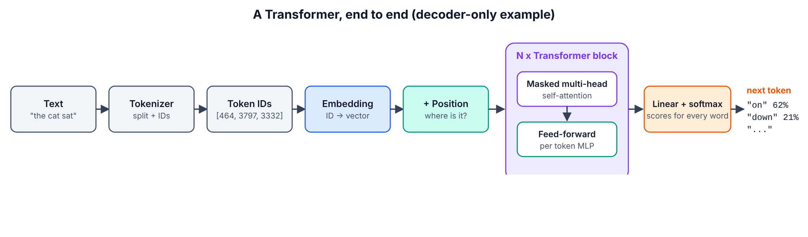

| # | Your topic | Guide section |
|---|---|---|
| 1 | Embeddings: from discrete to continuous space | Part 4 · 4.1 |
| 2 | The attention mechanism | Part 4 · 4.2 |
| 3 | Self-attention | Part 4 · 4.3 |
| 4 | Multi-head attention | Part 5 · 5.1 |
| 5 | Masked multi-head attention | Part 5 · 5.2 |
| 6 | Positional encoding | Part 5 · 5.3 (+ 5.4 full block) |
| 7 | Encoder–decoder Transformers | Part 6 · 6.1 (built from scratch in 6.4) |
| 8 | Encoder-only Transformers | Part 6 · 6.2 |
| 9 | Decoder-only Transformers | Part 6 · 6.3 |
| 10 | Cross-attention | Part 6 · 6.4 |
| — | How elite labs build them in 2026 | Part 7 |

## 0.3 Plan and time

| Part | What you will do | Time estimate |
|---|---|---|
| 0 Start Here | Understand the map | 20 min |
| 1 Prerequisites | Refresh 7 must-know ideas, prove each with a 1-minute check | 1–2 h |
| 2 Workspace | Set up Google Colab with a free GPU, run a test | 30 min |
| 3 Core Idea | One analogy + the 20% that explains 80% | 30 min |
| 4 Basics | Topics 1–3: embeddings, attention by hand, self-attention in real GPT-2 | 3–4 h |
| 5 Intermediate | Topics 4–6: build multi-head, masks, positional encodings, a full block | 4–5 h |
| 6 Advanced | Topics 7–10: use T5/BERT/Qwen, train your own GPT, build cross-attention | 6–8 h |
| 7 Elite | RoPE + RMSNorm + SwiGLU + GQA + KV cache; find induction heads in GPT-2 | 6–8 h |
| 8–14 | Tools map, maintenance, troubleshooting, projects, cheat sheet, self-test | 3–4 h |
| **Total** | | **≈ 25–35 hours** (2–3 weeks part-time) |

## 0.4 What you will be able to do at the end

1. Explain, with a drawing and numbers, how text becomes vectors and how attention mixes them — the standard whiteboard interview question.
2. Write multi-head attention, causal masking, sinusoidal positions and RoPE from scratch in PyTorch and prove they match PyTorch's official versions.
3. Train your own small GPT on Shakespeare and build an encoder–decoder model with cross-attention that you can inspect.
4. Pick the right family for a job (BERT-style for search/classification, T5-style for input→output, GPT-style for generation) and use real models from Hugging Face.
5. Upgrade a 2017 design to a 2026 "Llama/Qwen-style" design (RoPE, RMSNorm, SwiGLU, GQA, KV cache) and measure the speed-up.
6. Read modern architecture papers and run a mechanistic-interpretability experiment (induction heads).

## 0.5 Environment map

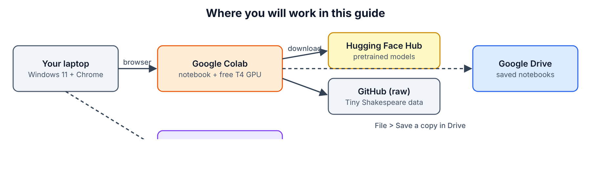

**One-line flow:** your Windows laptop → Chrome → Google Colab notebook running on Google's free T4 GPU → downloads models from Hugging Face Hub and data from GitHub → you save notebooks to Google Drive (and optionally push code to GitHub).

| Place | What you do there |
|---|---|
| Chrome on Windows 11 | Open Colab, Hugging Face, this guide |
| Google Colab (colab.research.google.com) | Write and run every lab, use the free GPU |
| Hugging Face Hub (huggingface.co) | Source of pretrained models (GPT-2, BERT, T5, MiniLM, Qwen3) |
| GitHub raw file | Source of the Tiny Shakespeare training text [28] |
| Google Drive | Where Colab stores your notebooks |
| VS Code on Windows (optional) | Run the same code locally on CPU |

## 0.6 What each piece does

| Component | Its job |
|---|---|
| Tokenizer | Cuts text into tokens (words or word-pieces) and gives each an ID number |
| Embedding table | Turns each token ID into a list of numbers (a vector) that carries meaning |
| Positional encoding | Adds "where in the sentence" information to each vector |
| Attention | Lets each token pull information from other tokens, weighted by relevance |
| Multi-head attention | Runs several attentions in parallel so each can track a different relationship |
| Mask | Blocks attention to tokens that must not be seen (future words, padding) |
| Feed-forward network (MLP) | Lets each token "think" on its own after it has gathered information |
| Residual connection + LayerNorm | Keep training stable when you stack many layers |
| Encoder | A stack of blocks that reads the full input with no mask |
| Decoder | A stack of blocks that writes output one token at a time with a causal mask |
| Cross-attention | The bridge where the decoder reads the encoder's output |
| LM head (Linear + softmax) | Converts the final vector into a probability for every word in the vocabulary |
| PyTorch | The library you use to build and train the networks |
| Hugging Face Transformers | The library that downloads and runs pretrained models in a few lines |
| Google Colab | Free online Python notebook with a GPU |

# PART 1 — Prerequisites

## 1.1 Checklist

| Item | Level |
|---|---|
| Python basics: variables, lists, dicts, functions, classes, loops | MUST |
| Tensors / arrays and their **shape** | MUST |
| Matrix multiplication (and transpose) | MUST |
| Dot product and cosine similarity | MUST |
| Softmax | MUST |
| What a neural network layer, loss and gradient descent are | MUST |
| PyTorch basics: `nn.Module`, `forward`, `loss.backward()`, optimizer | MUST |
| Logarithms and probability (why loss = −log p) | NICE-TO-HAVE |
| Git and GitHub | NICE-TO-HAVE |
| A Hugging Face account | NICE-TO-HAVE (needed only to upload your own models) |

## 1.2 Refreshers and 1-minute checks

Do each check in a Colab cell (you will set Colab up in Part 2 — if you have never used it, do Part 2 first and come back).

**1. Python classes.** A class bundles data and functions. In PyTorch every model is a class with an `__init__` (create layers) and a `forward` (use them).

*1-minute check* — predict the output, then run it:

```python
class Doubler:
    def __init__(self, k):
        self.k = k
    def forward(self, x):
        return x * 2 + self.k

d = Doubler(1)
print(d.forward(5))
```

Correct answer: `11`. If you guessed wrong, revise Python classes for one hour before continuing.

**2. Shapes.** A tensor is an n-dimensional array. Its *shape* says how many numbers sit on each axis. In this guide you will constantly see `(B, T, d)` = (batch of sentences, tokens per sentence, numbers per token).

*1-minute check:*

```python
import torch
x = torch.zeros(2, 6, 32)
print(x.shape, x[0].shape, x[:, -1].shape)
```

Correct answer: `torch.Size([2, 6, 32]) torch.Size([6, 32]) torch.Size([2, 32])`.

**3. Matrix multiplication.** `(n × k) @ (k × m)` gives `(n × m)`. The inner sizes must match. Transpose `.T` swaps rows and columns.

*1-minute check:* by hand, what is `[[1, 2], [3, 4]] @ [[1], [1]]`? Answer: `[[3], [7]]`. Then verify:

```python
import torch
print(torch.tensor([[1., 2.], [3., 4.]]) @ torch.tensor([[1.], [1.]]))
```

**4. Dot product and cosine similarity.** Dot product `a·b` = multiply matching numbers and add. Large positive = the vectors point the same way. Cosine similarity = dot product divided by both lengths, so it is always between −1 and 1.

*1-minute check:* `[1, 2] · [3, 4]` = 1×3 + 2×4 = **11**.

```python
import torch, torch.nn.functional as F
a, b = torch.tensor([1., 2.]), torch.tensor([3., 4.])
print(a @ b, F.cosine_similarity(a, b, dim=0))
```

Correct answer: `tensor(11.) tensor(0.9839)`.

**5. Softmax.** Turns any list of scores into positive numbers that add up to 1: `softmax(x)_i = e^(x_i) / Σ e^(x_j)`. Bigger score → bigger share.

*1-minute check:* softmax of `[0, 0]` is `[0.5, 0.5]`. Softmax of `[1, 0, 1]` ≈ `[0.42, 0.16, 0.42]` — you will reuse this exact example in Part 4.

```python
import torch
print(torch.softmax(torch.tensor([1., 0., 1.]), dim=0))
```

**6. Layer, loss, gradient descent.** A linear layer computes `y = xW + b`. The loss measures how wrong the output is. `loss.backward()` computes how each weight should change; the optimizer nudges the weights a little in that direction. Repeat thousands of times = training.

*1-minute check:* in words, what does `optimizer.zero_grad()` do? Answer: it clears the gradients from the previous step so they do not add up.

**7. PyTorch training loop.** Every training loop in this guide has the same 5 lines: get a batch → forward → loss → backward → optimizer step.

*1-minute check* — run it and confirm the loss goes down:

```python
import torch, torch.nn as nn
torch.manual_seed(0)
model = nn.Linear(1, 1)
opt = torch.optim.SGD(model.parameters(), lr=0.1)
x = torch.randn(64, 1); y = 3 * x + 1
for step in range(51):
    loss = ((model(x) - y) ** 2).mean()
    opt.zero_grad(); loss.backward(); opt.step()
    if step % 25 == 0: print(step, round(loss.item(), 4))
print(model.weight.item(), model.bias.item())
```

You should see the loss shrink towards 0 and the weight/bias approach 3 and 1.

## 1.3 What you must install, buy or sign up for

| Item | Official link | Cost | Which option to choose |
|---|---|---|---|
| Google account | accounts.google.com | Free | Any personal Gmail account |
| Google Colab | colab.research.google.com [3] | Free tier: T4 GPU when available, ~12 h max session, idle disconnect ~90 min [3][4] | **Free tier.** Colab Pro is $9.99/month for 100 compute units (verify on the signup page) — not needed for this guide |
| Chrome browser | google.com/chrome | Free | Latest version |
| Hugging Face account | huggingface.co/join [6] | Free (PRO is $9/month — not needed) | Free; only needed to upload your own models later |
| GitHub account (optional) | github.com/signup | Free | Free; to keep your notebooks under version control |
| Kaggle account (backup GPU) | kaggle.com [5] | Free, ~30 GPU-hours/week (floating, check your settings page) | Use only if Colab says no GPU is available |
| Python for Windows (optional) | python.org/downloads/windows [7] | Free | **Python 3.13** 64-bit. Newest is 3.15.0 (9 Oct 2026) but PyTorch wheels for a brand-new Python version can lag — 3.13 is the safe choice (verify on pytorch.org/get-started) |
| VS Code (optional) | code.visualstudio.com [8] | Free | "Windows x64 User Installer" + the **Python** and **Jupyter** extensions |

Nothing in Parts 2–7 costs money.

# PART 2 — Set Up Your Workspace

## SECTION 2.1 — Open Google Colab

**WHERE:** Chrome on your Windows laptop  
**GOAL:** Get a new, empty Colab notebook in front of you.

**Step 1.** Open Chrome.

**Step 2.** Click the address bar at the top.

**Step 3.** Type exactly and press **Enter**:

```text
colab.research.google.com
```

**Step 4.** If you are not signed in, click **Sign in** (top-right) and sign in with your Google account.

**Step 5.** In the "Open notebook" window, click **+ New notebook** (bottom-left). If no window appears, click **File > New notebook in Drive**.

> **You should see:** a page titled `Untitled0.ipynb` with one empty grey code cell and a ▶ button on its left.

**Step 6.** Click the title `Untitled0.ipynb` at the top-left.

**Step 7.** Type a new name and press **Enter**:

```text
T101_Part2_Setup.ipynb
```

> **Watch out:** Colab notebooks live in Google Drive under **My Drive > Colab Notebooks**. If you open a notebook from someone else's link, it is *not* saved for you until you click **File > Save a copy in Drive**.

**CHECKPOINT:** The tab shows `T101_Part2_Setup.ipynb` and there is one empty code cell.
*If not:* you are probably on the Colab welcome page — click **File > New notebook in Drive**.

## SECTION 2.2 — Switch on the free GPU

**WHERE:** Colab, the notebook from 2.1  
**GOAL:** Run your code on an NVIDIA T4 GPU instead of the CPU.

**Step 1.** Click **Runtime** in the top menu.

**Step 2.** Click **Change runtime type**.

**Step 3.** Fill the dialog using this table:

| Field | Value | Why |
|---|---|---|
| Runtime type | Python 3 | All code in this guide is Python |
| Hardware accelerator | **T4 GPU** | Free GPU, 15–16 GB memory, enough for every lab |

**Step 4.** Click **Save**.

**Step 5.** Click **Connect** (top-right) if it does not connect automatically.

> **You should see:** a green tick and "RAM / Disk" bars at the top-right.

| If you see... | It means... | Do this next |
|---|---|---|
| "Cannot connect to GPU backend" / "GPU not available" | Free GPUs are all busy right now | Click **Connect without GPU** (Parts 4–5 run fine on CPU), try again later, or use Kaggle (Part 10) |
| "T4 GPU" is greyed out | You hit the free usage limit for today | Wait several hours or use Kaggle |

**CHECKPOINT:** The runtime is connected and **Runtime > Change runtime type** shows **T4 GPU** selected.

## SECTION 2.3 — The "run a cell" routine (you will use it 100+ times)

**WHERE:** Colab notebook  
**GOAL:** Learn the exact 3 actions used for every code block in this guide.

**Step 1.** Click **+ Code** (top-left, under the menu). A new empty cell appears.

**Step 2.** Click inside the new cell.

**Step 3.** Paste the code block from the guide (**Ctrl+V**).

**Step 4.** Press **Shift+Enter** to run the cell.

> **You should see:** a spinning circle on the cell's ▶ button while it runs, then the output under the cell.

> **Watch out:** cells share memory **in the order you run them**, not the order on screen. If you get `NameError: name 'X' is not defined`, you skipped a cell — click **Runtime > Run before** on the failing cell, or run the missing cell.

**CHECKPOINT:** You know where **+ Code** is and that **Shift+Enter** runs a cell.

## SECTION 2.4 — Install / upgrade the libraries and run the test

**WHERE:** Colab notebook `T101_Part2_Setup.ipynb`  
**GOAL:** Prove PyTorch, the GPU and Hugging Face Transformers all work.

**Step 1.** Click **+ Code**.

**Step 2.** Paste exactly:

```python
!pip install -q -U transformers
```

**Step 3.** Press **Shift+Enter**.

> **You should see:** nothing, or a few quiet lines, after 10–60 seconds. A red "pip's dependency resolver" warning is normal and harmless.

**Step 4.** Click **Runtime > Restart session**, then click **Yes** in the dialog. (Older Colab versions call this "Restart runtime".)

**Step 5.** Click **+ Code**.

**Step 6.** Paste exactly:

```python
import sys, torch, transformers
print("Python      :", sys.version.split()[0])
print("PyTorch     :", torch.__version__)
print("Transformers:", transformers.__version__)
print("GPU         :", torch.cuda.get_device_name(0) if torch.cuda.is_available() else "none (CPU only)")
```

**Step 7.** Press **Shift+Enter**.

> **You should see** something like this (exact versions may differ — that is fine):

```text
Python      : 3.12.x
PyTorch     : 2.x.x+cu12x
Transformers: 5.20.0
GPU         : Tesla T4
```

**Step 8.** Click **+ Code**.

**Step 9.** Paste exactly — this is the "tiny test that proves everything works": it downloads GPT-2 from Hugging Face and asks it to continue a sentence.

```python
from transformers import pipeline
gen = pipeline("text-generation", model="openai-community/gpt2", device=0 if torch.cuda.is_available() else -1)
print(gen("A transformer is a neural network that", max_new_tokens=20, do_sample=False)[0]["generated_text"])
```

**Step 10.** Press **Shift+Enter**.

> **You should see:** download progress bars (about 550 MB), then this text (greedy decoding, so it should match exactly):

```text
A transformer is a neural network that can be used to generate a neural network.

The neural network is a neural network that can
```

> The text is repetitive and a bit silly — GPT-2 is small and from 2019. That is fine; the point is that everything works. A yellow "unauthenticated requests to the HF Hub" warning is harmless.

| If you see... | It means... | Do this next |
|---|---|---|
| `Transformers: 4.x` | The upgrade did not apply | Repeat Steps 1–4, making sure you **restarted the session** |
| `GPU: none (CPU only)` | GPU not attached | Redo Section 2.2 |
| `HTTPError 429` or slow download | Hugging Face rate limit | Wait 1 minute and run again |

**CHECKPOINT:** Transformers version is 5.x, GPU says `Tesla T4` (or you consciously chose CPU), and GPT-2 printed a sentence.
*If not:* see Part 10, rows 1–3.

## SECTION 2.5 — Optional: local setup on Windows 11 (CPU)

**WHERE:** Windows 11 — browser, then **Windows Terminal / PowerShell**, then **VS Code**  
**GOAL:** Run Parts 4–5 locally without internet GPU. (Parts 6–7 train faster on Colab's GPU.)

**Step 1.** In Chrome go to `https://www.python.org/downloads/windows/` [7].

**Step 2.** Click the newest **Python 3.13.x** link, then **Windows installer (64-bit)**.

**Step 3.** Run the downloaded installer.

**Step 4.** Tick **Add python.exe to PATH** at the bottom of the first screen.

**Step 5.** Click **Install Now** and wait for "Setup was successful", then click **Close**.

**Step 6.** Press the **Windows** key, type `PowerShell`, press **Enter**.

**Step 7.** Type and press **Enter**:

```powershell
mkdir $HOME\t101; cd $HOME\t101; python -m venv .venv
```

**Step 8.** Type and press **Enter**:

```powershell
.\.venv\Scripts\Activate.ps1
```

> **Watch out:** if you get "running scripts is disabled on this system", run `Set-ExecutionPolicy -Scope CurrentUser RemoteSigned`, answer `Y`, then repeat Step 8.

**Step 9.** Type and press **Enter** (CPU-only PyTorch is smaller and works on any laptop):

```powershell
pip install torch --index-url https://download.pytorch.org/whl/cpu
```

**Step 10.** Type and press **Enter**:

```powershell
pip install transformers matplotlib numpy jupyter
```

**Step 11.** Type and press **Enter**:

```powershell
python -c "import torch, transformers; print(torch.__version__, transformers.__version__)"
```

> **You should see:** `2.14.1+cpu 5.20.0` (or newer).

**Step 12.** Install VS Code from `https://code.visualstudio.com/` [8], open it, press **Ctrl+Shift+X**, search **Python**, click **Install**; search **Jupyter**, click **Install**.

**Step 13.** In VS Code click **File > Open Folder…**, choose `C:\Users\YOUR_USER\t101`, then **File > New File… > Jupyter Notebook**, and at the top-right click **Select Kernel > Python Environments > .venv**.

| Placeholder | Replace with | Example |
|---|---|---|
| `YOUR_USER` | Your Windows user folder name | `karthik` |

**CHECKPOINT:** Step 11 prints both versions, and a VS Code notebook cell running `print(1+1)` prints `2`.

# PART 3 — The Core Idea

## 3.1 One analogy: the meeting room

Imagine every word in a sentence is a **person in a meeting**.

- Each person holds a **card with facts about themselves** — that is their **embedding** (Topic 1).
- Each person wears a **name badge** saying what they can offer — the **Key**.
- Each person has a **question** they want answered — the **Query**.
- Each person also has the **actual information** they will share if asked — the **Value**.

When the meeting starts, every person reads every badge, decides how relevant each person is to their own question (Query·Key), and then takes notes from everyone, **mostly from the most relevant people** (softmax-weighted sum of Values). That is **self-attention** (Topics 2–3).

Now give everyone **several different questions at once** — "who is the subject?", "what is the verb?", "what was said nearby?" — each answered by a separate mini-meeting. That is **multi-head attention** (Topic 4).

If this meeting is for *writing a story one word at a time*, nobody may read notes from people who have not spoken yet — that is the **causal mask** (Topic 5). Because people in this room have no chairs in a row, you must also write their **seat numbers** on their cards — that is **positional encoding** (Topic 6).

Finally there are three kinds of meetings: one that only *understands* (encoder-only, BERT — Topic 8), one that only *writes* (decoder-only, GPT — Topic 9), and one where a *reading team* briefs a *writing team* (encoder–decoder, T5 — Topic 7). The briefing between teams is **cross-attention** (Topic 10).

## 3.2 The 20% of ideas that explain 80%

1. **Everything is vectors.** Text → token IDs → vectors (embeddings). Meaning = direction in space; similar meaning = high cosine similarity.
2. **Attention formula — memorise it:**
   `Attention(Q, K, V) = softmax(Q·Kᵀ / √d_k) · V`
   Q·Kᵀ = "how relevant is each word to each other word"; √d_k keeps the numbers calm; softmax turns scores into percentages; ·V blends information.
3. **Self-attention:** Q, K and V are all made from the *same* sentence by three learned matrices `W_Q, W_K, W_V`.
4. **Multi-head = split, attend, concat.** `d_model` is cut into `h` heads of size `d_model/h`; each head attends separately; results are glued back and mixed by `W_O`.
5. **Masks = set forbidden scores to −∞** before softmax so they become exactly 0.
6. **Attention has no sense of order** unless you add position information (sinusoidal, learned, or RoPE).
7. **A block = attention (words talk) + MLP (each word thinks) + residuals + norms.** Stack N blocks.
8. **Three families:** encoder-only (understand), decoder-only (generate), encoder–decoder (transform input to output). Cross-attention connects encoder and decoder.
9. **Training objective decides the family's skill:** BERT fills in masked words; GPT predicts the next token; T5 rewrites input into output.
10. **Cost:** attention compares every token with every token → memory and time grow with T² (sequence length squared). Most elite research (FlashAttention, GQA, MLA, KV cache, sparse/linear attention) attacks this cost.

That is the theory. Everything else in this guide is you proving these ten lines with your own code.


# PART 4 — BASICS (Topics 1, 2, 3)

You will build one Colab notebook, `T101_Part4_Basics.ipynb`, cell by cell. Every cell builds on the previous ones, so run them in order. A ready-made copy is in the repository at `transformers-101/notebooks/T101_Part4_Basics.ipynb`.

## SECTION 4.0 — Create the Part 4 notebook

**WHERE:** Google Colab in Chrome  
**GOAL:** A fresh notebook with PyTorch loaded and a GPU (or CPU) chosen.

**Step 1.** Click **File > New notebook in Drive**.

**Step 2.** Click the title and rename it to `T101_Part4_Basics.ipynb`, then press **Enter**.

**Step 3.** Click **Runtime > Change runtime type**, choose **T4 GPU**, click **Save**. (Part 4 also runs fine on CPU.)

**Step 4.** Click **+ Code**.

**Step 5.** Paste cell **4.0-A**:


```python
import torch
import torch.nn as nn
import torch.nn.functional as F
import matplotlib.pyplot as plt

torch.manual_seed(42)
device = "cuda" if torch.cuda.is_available() else "cpu"
print("torch", torch.__version__, "| device:", device)
```


**Step 6.** Press **Shift+Enter**.

> **You should see** (on Colab: `cuda` and a `+cu12x` version):

```text
torch 2.14.1+cpu | device: cpu
```


**What the non-obvious lines mean**

- `torch.nn` holds ready-made layers; `torch.nn.functional` (as `F`) holds plain functions such as `softmax` and `one_hot`.
- `torch.manual_seed(42)` makes random numbers repeatable, so your numbers match this guide.
- `device = ...` picks the GPU if one is attached.

**CHECKPOINT:** the cell printed a torch version and a device.
*If not:* `ModuleNotFoundError: torch` means you are not in Colab or not in your `.venv` — see Section 2.5 Step 8.

---

## 4.1 Topic 1 — Embeddings: from discrete to continuous space

**Concept (what, why, when).**
A computer cannot do maths on the word "cat", so we first give every token an **ID number** (discrete). IDs carry no meaning — ID 0 is not "closer" to ID 1 than to ID 4. An **embedding** replaces each ID with a learned **vector of real numbers** (continuous), so that words used in similar ways end up **close together in space**. Every Transformer starts with this lookup; its size is `vocab_size × d_model` (GPT-2: 50,257 × 768).

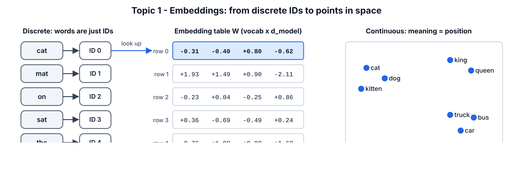

### SECTION 4.1.1 — Turn words into IDs

**WHERE:** Colab, `T101_Part4_Basics.ipynb`  
**GOAL:** Build the simplest possible tokenizer: one ID per unique word.

**Step 1.** Click **+ Code**.

**Step 2.** Paste cell **4.1-A**:


```python
sentence = "the cat sat on the mat"
words = sentence.split()
vocab = sorted(set(words))
stoi = {w: i for i, w in enumerate(vocab)}
itos = {i: w for w, i in stoi.items()}
ids = [stoi[w] for w in words]
print("words:", words)
print("vocab:", vocab)
print("ids  :", ids)
```


**Step 3.** Press **Shift+Enter**.

> **You should see:**

```text
words: ['the', 'cat', 'sat', 'on', 'the', 'mat']
vocab: ['cat', 'mat', 'on', 'sat', 'the']
ids  : [4, 0, 3, 2, 4, 1]
```


**Line by line:** `sorted(set(words))` keeps each unique word once in alphabetical order. `stoi` = "string to integer" (word → ID); `itos` is the reverse. "the" appears twice so its ID `4` appears twice.

**CHECKPOINT:** `ids` has 6 numbers and contains `4` twice.

### SECTION 4.1.2 — See why IDs and one-hot vectors are not enough

**WHERE:** same notebook  
**GOAL:** Prove that one-hot vectors say every word is equally different from every other word.

**Step 1.** Click **+ Code**.

**Step 2.** Paste cell **4.1-B**:


```python
one_hot = F.one_hot(torch.tensor(ids), num_classes=len(vocab)).float()
print(one_hot)
cat_vec, mat_vec = one_hot[1], one_hot[5]
print("cat . mat =", (cat_vec @ mat_vec).item())
print("cat . cat =", (cat_vec @ cat_vec).item())
```


**Step 3.** Press **Shift+Enter**.

> **You should see:**

```text
tensor([[0., 0., 0., 0., 1.],
        [1., 0., 0., 0., 0.],
        [0., 0., 0., 1., 0.],
        [0., 0., 1., 0., 0.],
        [0., 0., 0., 0., 1.],
        [0., 1., 0., 0., 0.]])
cat . mat = 0.0
cat . cat = 1.0
```


**Meaning:** a one-hot vector is all zeros with a single 1 at the word's ID. The dot product of *any two different* words is 0, so "cat" is exactly as unrelated to "mat" as to "the". With a 50,000-word vocabulary each one-hot vector also has 50,000 numbers — huge and empty.

**CHECKPOINT:** `cat . mat = 0.0` and `cat . cat = 1.0`.

### SECTION 4.1.3 — Build an embedding table and prove it is just a lookup

**WHERE:** same notebook  
**GOAL:** Create `nn.Embedding`, use it, and prove it equals "one-hot × matrix".

**Step 1.** Click **+ Code**.

**Step 2.** Paste cell **4.1-C**:


```python
d_model = 4
emb = nn.Embedding(num_embeddings=len(vocab), embedding_dim=d_model)
X = emb(torch.tensor(ids))
print("X shape:", tuple(X.shape))
print(X)
same = one_hot @ emb.weight
print("lookup == one_hot @ W ?", torch.allclose(X, same))
```


**Step 3.** Press **Shift+Enter**.

> **You should see:**

```text
X shape: (6, 4)
tensor([[-0.3097, -0.3957,  0.8034, -0.6216],
        [ 1.9269,  1.4873,  0.9007, -2.1055],
        [-0.2316,  0.0418, -0.2516,  0.8599],
        [ 0.3559, -0.6866, -0.4934,  0.2415],
        [-0.3097, -0.3957,  0.8034, -0.6216],
        [-0.7581,  1.0783,  0.8008,  1.6806]], grad_fn=<EmbeddingBackward0>)
lookup == one_hot @ W ? True
```


**Line by line**

- `nn.Embedding(num_embeddings=5, embedding_dim=4)` creates a 5 × 4 table of random numbers. Row *i* is the vector for ID *i*. These numbers are **trainable** — training moves them until similar words sit close together.
- `emb(torch.tensor(ids))` picks one row per ID → shape `(6, 4)`: 6 words, 4 numbers each.
- Rows 0 and 4 of `X` are identical because both are the word "the" (ID 4).
- `grad_fn=<EmbeddingBackward0>` means PyTorch remembers how this was computed so it can learn later.
- `one_hot @ emb.weight` gives exactly the same result: **an embedding layer is a one-hot vector multiplied by a weight matrix**, done efficiently as a lookup. This is a classic interview question.

**CHECKPOINT:** `X shape: (6, 4)` and `lookup == one_hot @ W ? True`.

### SECTION 4.1.4 — Measure meaning in a real trained model (GPT-2)

**WHERE:** same notebook (needs internet; downloads ~550 MB once)  
**GOAL:** See that trained embeddings put related words close together.

**Step 1.** Click **+ Code**.

**Step 2.** Paste cell **4.1-D**:


```python
from transformers import AutoTokenizer, AutoModel

tok = AutoTokenizer.from_pretrained("openai-community/gpt2")
gpt2 = AutoModel.from_pretrained("openai-community/gpt2", attn_implementation="eager")
E = gpt2.get_input_embeddings().weight.detach()
print("GPT-2 embedding table:", tuple(E.shape))

def vec(word):
    token_ids = tok.encode(" " + word)
    assert len(token_ids) == 1, f"'{word}' splits into {len(token_ids)} tokens"
    return E[token_ids[0]]

def cos(a, b):
    return F.cosine_similarity(vec(a), vec(b), dim=0).item()

pairs = [("king", "queen"), ("king", "man"), ("king", "banana"),
         ("Paris", "London"), ("Paris", "pizza"), ("happy", "glad"), ("happy", "truck")]
for a, b in pairs:
    print(f"{a:>6} vs {b:<7} cosine = {cos(a, b):.3f}")
```


**Step 3.** Press **Shift+Enter**.

> **You should see:**

```text
GPT-2 embedding table: (50257, 768)
  king vs queen   cosine = 0.657
  king vs man     cosine = 0.367
  king vs banana  cosine = 0.256
 Paris vs London  cosine = 0.579
 Paris vs pizza   cosine = 0.249
 happy vs glad    cosine = 0.624
 happy vs truck   cosine = 0.233
```


**Line by line**

- `AutoTokenizer` / `AutoModel` download GPT-2's tokenizer and network from Hugging Face. `attn_implementation="eager"` asks for the plain attention code so we can read the attention weights later (the fast default does not return them).
- `get_input_embeddings().weight` is GPT-2's embedding table: **50,257 tokens × 768 numbers**.
- `tok.encode(" " + word)` — GPT-2 tokens include the leading space, so " king" is one token but "king" at the start of text may be a different token.
- The `assert` stops you if a word is split into several tokens (then it has no single vector).
- `F.cosine_similarity` gives a number between −1 and 1; higher = more similar direction.

Related pairs (king–queen 0.66, happy–glad 0.62, Paris–London 0.58) score far higher than unrelated pairs (≈0.23–0.26). Nobody programmed this — it emerged from training on text.

> **Watch out:** cosine values in raw input embeddings are modest and noisy. Do not expect `king − man + woman = queen` to work perfectly in GPT-2's token table; that famous trick was shown on word2vec. Contextual embeddings (Part 6.2) are far richer.

**CHECKPOINT:** `king vs queen` is clearly higher than `king vs banana`.
*If not:* an `AssertionError ... splits into 2 tokens` means you changed a word — pick a common English word.

### SECTION 4.1.5 — Draw the embedding space

**WHERE:** same notebook  
**GOAL:** Squash 768-dimensional vectors to 2-D and look at the clusters.

**Step 1.** Click **+ Code**.

**Step 2.** Paste cell **4.1-E**:


```python
plot_words = ["king", "queen", "man", "woman", "prince", "apple", "banana", "orange",
              "car", "bus", "train", "truck", "Monday", "Friday", "Sunday"]
V = torch.stack([vec(w) for w in plot_words])
V = V - V.mean(dim=0)
U, S, Vt = torch.linalg.svd(V, full_matrices=False)
P = V @ Vt[:2].T
plt.figure(figsize=(6.5, 5))
plt.scatter(P[:, 0], P[:, 1])
for w, (x, y) in zip(plot_words, P.tolist()):
    plt.annotate(w, (x, y), fontsize=11)
plt.title("GPT-2 token embeddings squashed to 2-D (PCA)")
plt.show()
```


**Step 3.** Press **Shift+Enter**.

> **You should see** a scatter plot like this one — royals in one corner, fruit and vehicles in another region, weekdays bunched together:

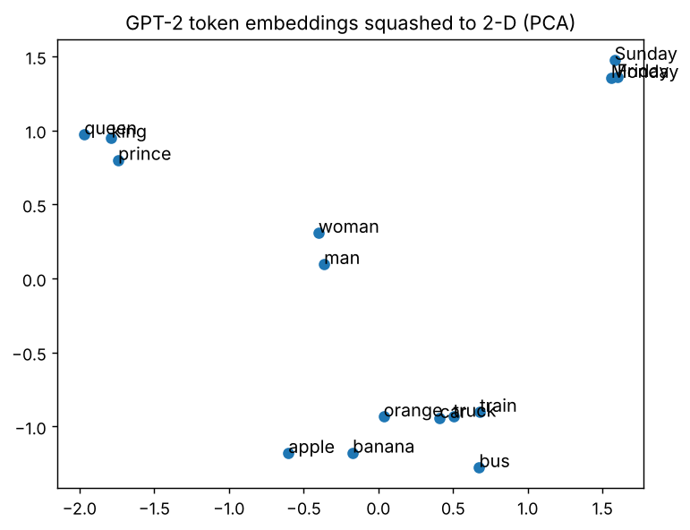

**Line by line:** `V - V.mean(dim=0)` centres the cloud; `torch.linalg.svd` finds the two directions in which the 15 vectors spread out most (this is **PCA**); `V @ Vt[:2].T` projects every word onto those two directions so we can plot them.

**CHECKPOINT:** king/queen/prince are near each other and far from car/bus/truck.

**Common mistake at this level — confusing the tokenizer with the embedding.**
The tokenizer is fixed text-processing (string → IDs, no learning). The embedding is a trainable layer (ID → vector). *How to spot it:* if you think you can "train the tokenizer with backprop", or you load a model with a *different* tokenizer than it was trained with, outputs become garbage. Always load the tokenizer and model from the **same** name.

---

## 4.2 Topic 2 — The attention mechanism

**Concept.** Attention is a **soft lookup**. You have a *question* (query vector **q**), a set of *labels* (key vectors **K**) and the *content* behind each label (value vectors **V**). You score the question against every label with a dot product, turn the scores into percentages with softmax, and return the **weighted blend of the contents**. It was first used in 2014 to let a translation model look back at the most relevant source words [10]; the Transformer made it the *only* mechanism for mixing information between words [9].

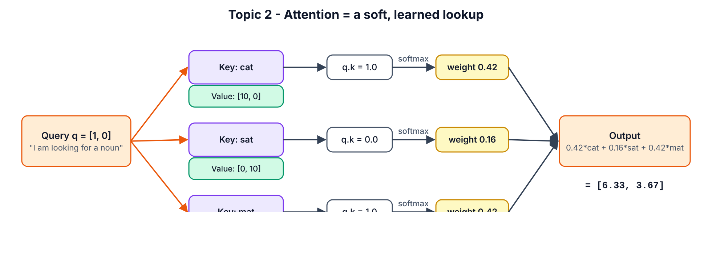

### SECTION 4.2.1 — Do one attention step by hand

**WHERE:** paper and pen first, then the same notebook  
**GOAL:** Calculate attention manually, then confirm with code.

The setup: three words, each with a 2-number key. Read number 1 as "is a noun" and number 2 as "is about sitting". So `cat = [1, 0]`, `sat = [0, 1]`, `mat = [1, 1]`. The query `q = [1, 0]` means "I am looking for a noun".

**Step 1.** On paper, compute the scores `q · key`:
cat: 1×1 + 0×0 = **1**; sat: 1×0 + 0×1 = **0**; mat: 1×1 + 0×1 = **1**.

**Step 2.** On paper, compute softmax of `[1, 0, 1]`:
e¹ = 2.718, e⁰ = 1, e¹ = 2.718; sum = 6.437 → weights **[0.422, 0.155, 0.422]**.

**Step 3.** On paper, blend the values `[10,0]`, `[0,10]`, `[5,5]`:
0.422×[10,0] + 0.155×[0,10] + 0.422×[5,5] = [4.22+2.11, 1.55+2.11] = **[6.33, 3.67]**.

**Step 4.** Click **+ Code**.

**Step 5.** Paste cell **4.2-A**:


```python
keys = torch.tensor([[1.0, 0.0],    # "cat"
                     [0.0, 1.0],    # "sat"
                     [1.0, 1.0]])   # "mat"
values = torch.tensor([[10.0, 0.0],
                       [0.0, 10.0],
                       [5.0, 5.0]])
query = torch.tensor([1.0, 0.0])
scores = keys @ query
weights = torch.softmax(scores, dim=0)
output = weights @ values
print("scores :", scores)
print("weights:", weights.round(decimals=4))
print("output :", output.round(decimals=3))
```


**Step 6.** Press **Shift+Enter**.

> **You should see:**

```text
scores : tensor([1., 0., 1.])
weights: tensor([0.4223, 0.1554, 0.4223])
output : tensor([6.3350, 3.6650])
```


**CHECKPOINT:** your paper answer matches `[6.335, 3.665]` (tiny rounding differences are fine).

### SECTION 4.2.2 — Why we divide by √d_k

**WHERE:** same notebook  
**GOAL:** See softmax "saturate" when vectors are long, and how scaling fixes it.

**Step 1.** Click **+ Code**.

**Step 2.** Paste cell **4.2-B**:


```python
torch.manual_seed(0)
for d in [2, 64, 512]:
    q = torch.randn(d)
    K = torch.randn(5, d)
    raw = K @ q
    w_raw = torch.softmax(raw, dim=0).max().item()
    w_scaled = torch.softmax(raw / d ** 0.5, dim=0).max().item()
    print(f"d={d:4d}  score std={raw.std().item():6.2f}  "
          f"biggest weight: unscaled={w_raw:.3f}  scaled={w_scaled:.3f}")
```


**Step 3.** Press **Shift+Enter**.

> **You should see:**

```text
d=   2  score std=  1.41  biggest weight: unscaled=0.578  scaled=0.466
d=  64  score std=  3.94  biggest weight: unscaled=0.493  scaled=0.273
d= 512  score std= 20.15  biggest weight: unscaled=1.000  scaled=0.506
```


**Meaning:** a dot product of two random vectors with `d` numbers has a spread (standard deviation) of about √d. At d = 512 the scores are so large that softmax gives **one word 100% and all others 0%** — the gradient for the others becomes ~0 and learning stalls. Dividing by √d brings the spread back to ≈1 so softmax stays "soft". That is the `/ √d_k` in the formula.

**CHECKPOINT:** at `d=512`, unscaled biggest weight is `1.000` and scaled is much smaller.

### SECTION 4.2.3 — Write the general attention function

**WHERE:** same notebook  
**GOAL:** One reusable function `attention(Q, K, V, mask)` that you will use for the rest of Part 4, verified against PyTorch.

**Step 1.** Click **+ Code**.

**Step 2.** Paste cell **4.2-C**:


```python
def attention(Q, K, V, mask=None):
    d_k = Q.size(-1)
    scores = Q @ K.transpose(-2, -1) / d_k ** 0.5
    if mask is not None:
        scores = scores.masked_fill(mask == 0, float("-inf"))
    weights = torch.softmax(scores, dim=-1)
    return weights @ V, weights

torch.manual_seed(1)
Q = torch.randn(1, 6, 8)
K = torch.randn(1, 6, 8)
V = torch.randn(1, 6, 8)
mine, w = attention(Q, K, V)
official = F.scaled_dot_product_attention(Q, K, V)
print("output shape :", tuple(mine.shape))
print("weights shape:", tuple(w.shape))
print("each row of weights sums to 1:", torch.allclose(w.sum(-1), torch.ones(1, 6)))
print("matches PyTorch SDPA:", torch.allclose(mine, official, atol=1e-6))
```


**Step 3.** Press **Shift+Enter**.

> **You should see:**

```text
output shape : (1, 6, 8)
weights shape: (1, 6, 6)
each row of weights sums to 1: True
matches PyTorch SDPA: True
```


**Line by line**

- `K.transpose(-2, -1)` flips the last two axes so `Q @ Kᵀ` compares every query with every key → a `T × T` score grid.
- `masked_fill(mask == 0, -inf)` — where the mask says "not allowed", put −∞. `e^(−∞) = 0`, so those positions get exactly 0 weight. You will use this in Topic 5.
- `torch.softmax(scores, dim=-1)` normalises **each row** (each query) to sum to 1.
- `F.scaled_dot_product_attention` is PyTorch's official, fast (fused, FlashAttention-style) version [34]. Matching it proves your maths is right.

**CHECKPOINT:** both checks print `True`.

**Common mistake at this level — softmax over the wrong axis.**
`softmax(scores, dim=0)` normalises over queries instead of keys. The code still runs but the model learns nonsense. *How to spot it:* `w.sum(-1)` is not all ones. Always use `dim=-1` (last axis = keys).

---

## 4.3 Topic 3 — Self-attention

**Concept.** In **self**-attention the queries, keys and values all come from the **same sentence**. Every token's embedding `x` is multiplied by three learned matrices: `Q = x·W_Q`, `K = x·W_K`, `V = x·W_V`. Then every token attends to every token of its own sentence. The output is a new vector per token that has "absorbed" context — "it" can pull in information from "animal". Use it whenever tokens in one sequence need to understand each other (every Transformer layer does this).

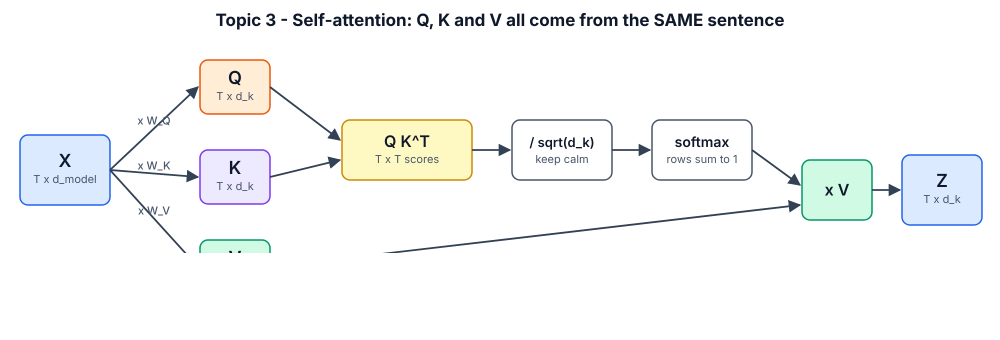

### SECTION 4.3.1 — Build a self-attention layer

**WHERE:** same notebook  
**GOAL:** Wrap `attention()` in an `nn.Module` with learnable `W_Q, W_K, W_V` and run it on our 6-word sentence.

**Step 1.** Click **+ Code**.

**Step 2.** Paste cell **4.3-A**:


```python
class SelfAttention(nn.Module):
    def __init__(self, d_model, d_k):
        super().__init__()
        self.W_q = nn.Linear(d_model, d_k, bias=False)
        self.W_k = nn.Linear(d_model, d_k, bias=False)
        self.W_v = nn.Linear(d_model, d_k, bias=False)

    def forward(self, x, mask=None):
        Q = self.W_q(x)
        K = self.W_k(x)
        V = self.W_v(x)
        return attention(Q, K, V, mask)

torch.manual_seed(42)
sa = SelfAttention(d_model=4, d_k=4)
x = X.detach().unsqueeze(0)
out, w = sa(x)
print("input  :", tuple(x.shape))
print("output :", tuple(out.shape))
print("weights:", tuple(w.shape))
print(w[0].detach().round(decimals=2))
```


**Step 3.** Press **Shift+Enter**.

> **You should see:**

```text
input  : (1, 6, 4)
output : (1, 6, 4)
weights: (1, 6, 6)
tensor([[0.2100, 0.1700, 0.1400, 0.1400, 0.2100, 0.1300],
        [0.2200, 0.3100, 0.0700, 0.1200, 0.2200, 0.0500],
        [0.1400, 0.1400, 0.2000, 0.1800, 0.1400, 0.2100],
        [0.1700, 0.1500, 0.1700, 0.1700, 0.1700, 0.1700],
        [0.2100, 0.1700, 0.1400, 0.1400, 0.2100, 0.1300],
        [0.1200, 0.1500, 0.2100, 0.2000, 0.1200, 0.2000]])
```


**Line by line**

- `nn.Linear(d_model, d_k, bias=False)` is a learnable matrix of size `d_model × d_k`. Three of them make Q, K, V from the same input.
- `X.detach().unsqueeze(0)` — `detach()` cuts the link to the embedding's gradient (we only want the numbers); `unsqueeze(0)` adds a batch axis: `(6, 4)` → `(1, 6, 4)`.
- The weight grid is 6 × 6: row = word looking, column = word looked at. Each row sums to 1.
- Rows 0 and 4 are identical — both are "the", with the same embedding and **no position information**. Hold that thought for Topic 6.
- The weights are fairly flat because `W_Q, W_K, W_V` are random. Training is what makes them sharp and meaningful — next you look at a *trained* model.

**CHECKPOINT:** output shape `(1, 6, 4)`, weights shape `(1, 6, 6)`.

### SECTION 4.3.2 — Find a real "it → animal" head in GPT-2

**WHERE:** same notebook (uses `gpt2` loaded in 4.1-D)  
**GOAL:** See trained self-attention resolve a pronoun.

**Step 1.** Click **+ Code**.

**Step 2.** Paste cell **4.3-B**:


```python
text = "The animal didn't cross the street because it was too tired"
enc = tok(text, return_tensors="pt")
tokens = tok.convert_ids_to_tokens(enc["input_ids"][0])
with torch.no_grad():
    res = gpt2(**enc, output_attentions=True)
att = torch.stack(res.attentions)[:, 0]
it_pos = tokens.index("Ġit")
animal_pos = tokens.index("Ġanimal")
street_pos = tokens.index("Ġstreet")
score = att[:, :, it_pos, animal_pos]
layer, head = divmod(score.argmax().item(), score.shape[1])
print("number of layers x heads:", tuple(score.shape))
print(f"best 'it'->'animal' head: layer {layer}, head {head}")
print(f"  weight on 'animal' = {att[layer, head, it_pos, animal_pos].item():.2f}")
print(f"  weight on 'street' = {att[layer, head, it_pos, street_pos].item():.2f}")
```


**Step 3.** Press **Shift+Enter**.

> **You should see:**

```text
number of layers x heads: (12, 12)
best 'it'->'animal' head: layer 4, head 3
  weight on 'animal' = 0.85
  weight on 'street' = 0.00
```


**Line by line**

- `output_attentions=True` makes the model return the attention weights of all **12 layers × 12 heads**.
- `torch.stack(res.attentions)[:, 0]` → shape `(layers, heads, T, T)`; `[:, 0]` drops the batch axis.
- `"Ġit"` — GPT-2 writes a leading space as `Ġ`.
- `att[:, :, it_pos, animal_pos]` = for every layer and head, how much "it" attends to "animal". `argmax` finds the strongest head; `divmod` converts the flat index back to (layer, head).
- One head puts **85%** of "it"'s attention on "animal" and **0%** on "street". Nobody wrote a pronoun rule; training discovered it.

**CHECKPOINT:** the best head puts a clearly bigger weight on "animal" than on "street".

### SECTION 4.3.3 — Plot the attention map

**WHERE:** same notebook  
**GOAL:** A heatmap of that head.

**Step 1.** Click **+ Code**.

**Step 2.** Paste cell **4.3-C**:


```python
clean = [t.replace("Ġ", "") for t in tokens]
A = att[layer, head].numpy()
plt.figure(figsize=(7, 6))
plt.imshow(A, cmap="viridis")
plt.xticks(range(len(clean)), clean, rotation=90)
plt.yticks(range(len(clean)), clean)
plt.xlabel("looked at (key)")
plt.ylabel("looking (query)")
plt.title(f"GPT-2 self-attention, layer {layer} head {head}")
plt.colorbar()
plt.tight_layout()
plt.show()
```


**Step 3.** Press **Shift+Enter**.

> **You should see:**

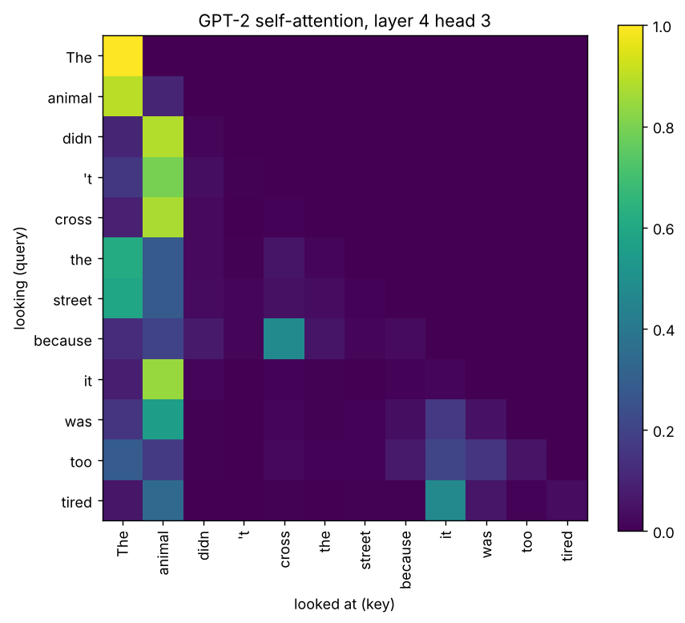

**How to read it:** each row is a word "asking"; bright squares show where it looks. The upper-right triangle is black because GPT-2 is a *decoder* and cannot look at future words (Topic 5). The bright square in row **it**, column **animal** is the coreference you just measured. The bright first column is a known "attention sink": heads park unused attention on the first token.

**CHECKPOINT:** row "it" is brightest under "animal". Save your notebook: **File > Save** (Ctrl+S).

**Common mistake at this level — believing one attention map "explains" the model.**
A single head is one of 144 in GPT-2 small, and information also flows through MLPs and residuals. *How to spot it:* if you are making claims from one heatmap, check other layers/heads and test with interventions (Part 7.3 shows a proper measurement).

**Level-up check (Part 4 done):** you can explain "embedding = learned lookup table", compute attention by hand, and you have seen a trained head resolve "it".


# PART 5 — INTERMEDIATE (Topics 4, 5, 6 + the full block)

Part 4 used one attention "head" with toy sizes. Now you build the real thing: batched **multi-head** attention, **masks**, **positional encodings** (including RoPE, used by almost every 2026 LLM), and the complete **Transformer block** that Part 6 stacks into whole models.

## SECTION 5.0 — Create the Part 5 notebook

**WHERE:** Google Colab  
**GOAL:** Fresh notebook with imports.

**Step 1.** Click **File > New notebook in Drive**.

**Step 2.** Rename it to `T101_Part5_Intermediate.ipynb`.

**Step 3.** Click **Runtime > Change runtime type > T4 GPU > Save** (CPU also works for Part 5).

**Step 4.** Click **+ Code**.

**Step 5.** Paste cell **5.0-A**:


```python
import math
import torch
import torch.nn as nn
import torch.nn.functional as F
import matplotlib.pyplot as plt

torch.manual_seed(42)
device = "cuda" if torch.cuda.is_available() else "cpu"
print("torch", torch.__version__, "| device:", device)
```


**Step 6.** Press **Shift+Enter**.

> **You should see:**

```text
torch 2.14.1+cpu | device: cpu
```


**CHECKPOINT:** a torch version and device are printed.

---

## 5.1 Topic 4 — Multi-head attention

**Concept.** One attention head can only express one "kind of relevance" per layer. **Multi-head attention** splits the model width `d_model` into `h` smaller heads (e.g. 512 = 8 × 64). Each head has its own Q/K/V projections, attends independently, and the head outputs are concatenated and mixed by an output matrix `W_O`. It costs about the same as one big head but lets the layer track several relationships at once (syntax, coreference, nearby words…). Every Transformer uses it.

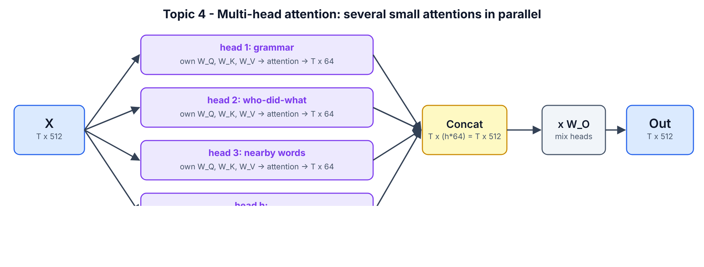

### SECTION 5.1.1 — Build `MultiHeadAttention`

**WHERE:** Colab, `T101_Part5_Intermediate.ipynb`  
**GOAL:** A batched multi-head attention module you will reuse in Parts 5 and 6.

**Step 1.** Click **+ Code**.

**Step 2.** Paste cell **5.1-A**:


```python
class MultiHeadAttention(nn.Module):
    def __init__(self, d_model, n_heads, dropout=0.0):
        super().__init__()
        assert d_model % n_heads == 0, "d_model must be divisible by n_heads"
        self.n_heads = n_heads
        self.d_head = d_model // n_heads
        self.W_q = nn.Linear(d_model, d_model)
        self.W_k = nn.Linear(d_model, d_model)
        self.W_v = nn.Linear(d_model, d_model)
        self.W_o = nn.Linear(d_model, d_model)
        self.dropout = nn.Dropout(dropout)

    def split_heads(self, x):
        B, T, _ = x.shape
        return x.view(B, T, self.n_heads, self.d_head).transpose(1, 2)

    def forward(self, x_q, x_kv=None, mask=None):
        if x_kv is None:
            x_kv = x_q
        Q = self.split_heads(self.W_q(x_q))
        K = self.split_heads(self.W_k(x_kv))
        V = self.split_heads(self.W_v(x_kv))
        scores = Q @ K.transpose(-2, -1) / math.sqrt(self.d_head)
        if mask is not None:
            scores = scores.masked_fill(mask == 0, float("-inf"))
        weights = self.dropout(torch.softmax(scores, dim=-1))
        out = weights @ V
        B, H, T, Dh = out.shape
        out = out.transpose(1, 2).contiguous().view(B, T, H * Dh)
        return self.W_o(out), weights

mha = MultiHeadAttention(d_model=32, n_heads=4)
x = torch.randn(2, 6, 32)
y, w = mha(x)
print("input  x      :", tuple(x.shape))
print("output y      :", tuple(y.shape))
print("weights       :", tuple(w.shape), "<- (batch, heads, query, key)")
print("parameters    :", sum(p.numel() for p in mha.parameters()))
```


**Step 3.** Press **Shift+Enter**.

> **You should see:**

```text
input  x      : (2, 6, 32)
output y      : (2, 6, 32)
weights       : (2, 4, 6, 6) <- (batch, heads, query, key)
parameters    : 4224
```


**Line by line**

- `assert d_model % n_heads == 0` — each head gets an equal slice, so `d_model` must divide evenly.
- `W_q, W_k, W_v` are each `d_model × d_model`. This is the same as having `h` separate `d_model × d_head` matrices side by side — one big matrix is faster on a GPU.
- `split_heads`: `view(B, T, h, d_head)` cuts the last axis into heads; `transpose(1, 2)` moves heads in front of tokens so every head is processed like a separate batch item.
- `x_kv=None` — if you pass only `x_q`, keys and values come from the same input (**self**-attention). Passing a *different* `x_kv` turns this exact class into **cross**-attention (Topic 10).
- `math.sqrt(self.d_head)` — scale by the **head** size, not `d_model`.
- `transpose(1, 2).contiguous().view(B, T, H*Dh)` glues the heads back together. `.contiguous()` is needed because `transpose` only changes how memory is read; `view` needs memory laid out in order.
- Parameters: 4 matrices × (32×32 weights + 32 biases) = 4 × 1,056 = **4,224**.

**CHECKPOINT:** weights shape is `(2, 4, 6, 6)` = (batch, heads, query, key).

### SECTION 5.1.2 — Trace every shape

**WHERE:** same notebook  
**GOAL:** Watch the tensor change shape at each step (the #1 skill for debugging Transformers).

**Step 1.** Click **+ Code**.

**Step 2.** Paste cell **5.1-B**:


```python
B, T, D, H = 2, 6, 32, 4
q = mha.W_q(x)
print("1. after W_q              :", tuple(q.shape))
q = q.view(B, T, H, D // H)
print("2. view into heads        :", tuple(q.shape))
q = q.transpose(1, 2)
print("3. heads to the front     :", tuple(q.shape))
k = mha.W_k(x).view(B, T, H, D // H).transpose(1, 2)
s = q @ k.transpose(-2, -1)
print("4. scores per head        :", tuple(s.shape))
o = torch.softmax(s / math.sqrt(D // H), -1) @ mha.W_v(x).view(B, T, H, D // H).transpose(1, 2)
print("5. weighted values        :", tuple(o.shape))
o = o.transpose(1, 2).reshape(B, T, D)
print("6. heads glued back       :", tuple(o.shape))
```


**Step 3.** Press **Shift+Enter**.

> **You should see:**

```text
1. after W_q              : (2, 6, 32)
2. view into heads        : (2, 6, 4, 8)
3. heads to the front     : (2, 4, 6, 8)
4. scores per head        : (2, 4, 6, 6)
5. weighted values        : (2, 4, 6, 8)
6. heads glued back       : (2, 6, 32)
```


| Step | Shape | Plain words |
|---|---|---|
| 1 | (B, T, D) | one 32-number vector per token |
| 2 | (B, T, H, D/H) | each vector cut into 4 pieces of 8 |
| 3 | (B, H, T, D/H) | group by head |
| 4 | (B, H, T, T) | each head: every token vs every token |
| 5 | (B, H, T, D/H) | each head: blended values |
| 6 | (B, T, D) | heads glued back to 32 numbers per token |

**CHECKPOINT:** the last shape equals the first shape — attention never changes `(B, T, D)`.

### SECTION 5.1.3 — Prove it equals PyTorch's official layer

**WHERE:** same notebook  
**GOAL:** Copy your weights into `nn.MultiheadAttention` and check the outputs match.

**Step 1.** Click **+ Code**.

**Step 2.** Paste cell **5.1-C**:


```python
ref = nn.MultiheadAttention(embed_dim=32, num_heads=4, batch_first=True)
with torch.no_grad():
    ref.in_proj_weight.copy_(torch.cat([mha.W_q.weight, mha.W_k.weight, mha.W_v.weight]))
    ref.in_proj_bias.copy_(torch.cat([mha.W_q.bias, mha.W_k.bias, mha.W_v.bias]))
    ref.out_proj.weight.copy_(mha.W_o.weight)
    ref.out_proj.bias.copy_(mha.W_o.bias)
y_ref, _ = ref(x, x, x)
print("my MHA == torch.nn.MultiheadAttention:", torch.allclose(y, y_ref, atol=1e-6))
```


**Step 3.** Press **Shift+Enter**.

> **You should see:**

```text
my MHA == torch.nn.MultiheadAttention: True
```


**Line by line:** PyTorch stores Q, K and V weights stacked in one `in_proj_weight` of shape `(3·D, D)`, so we `torch.cat` ours in the order Q, K, V. `torch.no_grad()` lets us overwrite parameters without recording gradients. `batch_first=True` makes PyTorch use `(B, T, D)` like we do.

**CHECKPOINT:** `True`. You have now written production-equivalent multi-head attention.

**Common mistake at this level — `view` instead of `transpose` (or the reverse).**
Writing `x.view(B, H, T, d_head)` directly *runs* but scrambles tokens across heads. *How to spot it:* the comparison in 5.1-C prints `False`, or a model trains but stays bad. Always `view(B, T, H, d_head)` **then** `transpose(1, 2)`.

---

## 5.2 Topic 5 — Masked multi-head attention

**Concept.** A **mask** forbids some attention links by setting their scores to −∞ before softmax. Two kinds matter:
(1) the **causal (look-ahead) mask** — when a model learns to predict the next word, position *t* must not see positions after *t*, otherwise it just copies the answer; this is the "masked multi-head attention" inside every decoder;
(2) the **padding mask** — batches contain sentences of different lengths padded with a PAD token, and nobody should attend to PAD.

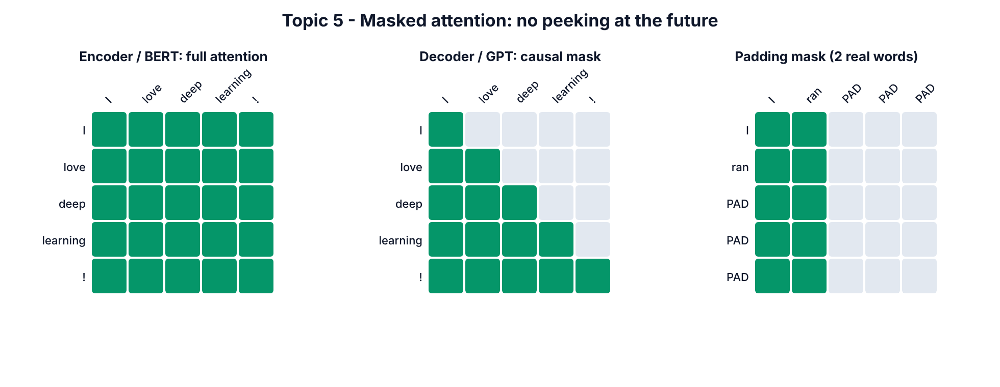

### SECTION 5.2.1 — Build the causal mask

**WHERE:** same notebook  
**GOAL:** A lower-triangular matrix of 1s.

**Step 1.** Click **+ Code**.

**Step 2.** Paste cell **5.2-A**:


```python
def causal_mask(T):
    return torch.tril(torch.ones(T, T)).view(1, 1, T, T)

print(causal_mask(5)[0, 0])
```


**Step 3.** Press **Shift+Enter**.

> **You should see:**

```text
tensor([[1., 0., 0., 0., 0.],
        [1., 1., 0., 0., 0.],
        [1., 1., 1., 0., 0.],
        [1., 1., 1., 1., 0.],
        [1., 1., 1., 1., 1.]])
```


**Meaning:** row = query position, column = key position. Row 2 (third word) may see columns 0, 1, 2 only. `torch.tril` keeps the lower triangle. `.view(1, 1, T, T)` adds batch and head axes so it broadcasts over every batch item and every head.

**CHECKPOINT:** 1s on and below the diagonal, 0s above.

### SECTION 5.2.2 — Prove the mask stops "cheating"

**WHERE:** same notebook  
**GOAL:** Change the last word and show that, with the mask, no earlier output changes.

**Step 1.** Click **+ Code**.

**Step 2.** Paste cell **5.2-B**:


```python
torch.manual_seed(0)
x1 = torch.randn(1, 6, 32)
x2 = x1.clone()
x2[0, -1] = torch.randn(32)
mask = causal_mask(6)
y1, w1 = mha(x1, mask=mask)
y2, _ = mha(x2, mask=mask)
print("WITH mask   : first 5 outputs unchanged? ", torch.allclose(y1[0, :5], y2[0, :5], atol=1e-6))
print("WITH mask   : last output changed?       ", not torch.allclose(y1[0, 5], y2[0, 5]))
u1, _ = mha(x1)
u2, _ = mha(x2)
print("WITHOUT mask: first 5 outputs unchanged? ", torch.allclose(u1[0, :5], u2[0, :5], atol=1e-6))
print("head 0 weights with mask:")
print(w1[0, 0].detach().round(decimals=2))
```


**Step 3.** Press **Shift+Enter**.

> **You should see:**

```text
WITH mask   : first 5 outputs unchanged?  True
WITH mask   : last output changed?        True
WITHOUT mask: first 5 outputs unchanged?  False
head 0 weights with mask:
tensor([[1.0000, 0.0000, 0.0000, 0.0000, 0.0000, 0.0000],
        [0.4800, 0.5200, 0.0000, 0.0000, 0.0000, 0.0000],
        [0.3300, 0.3600, 0.3100, 0.0000, 0.0000, 0.0000],
        [0.2900, 0.1600, 0.2600, 0.2900, 0.0000, 0.0000],
        [0.1600, 0.3400, 0.1800, 0.1200, 0.2000, 0.0000],
        [0.1600, 0.1400, 0.1900, 0.1800, 0.1700, 0.1600]])
```


**Meaning:** `x2` is `x1` with only the last token replaced. With the causal mask, the first 5 outputs are identical — the future cannot leak backwards. Without the mask, every output changes because every token saw the changed last token. The weight grid shows zeros above the diagonal, and row 0 puts 100% on itself (it can see nothing else).

**CHECKPOINT:** `True`, `True`, `False` in that order.

### SECTION 5.2.3 — Padding mask and combining masks

**WHERE:** same notebook  
**GOAL:** Hide PAD tokens and combine with the causal mask.

**Step 1.** Click **+ Code**.

**Step 2.** Paste cell **5.2-C**:


```python
tokens = torch.tensor([[5, 7, 9, 0, 0],
                       [3, 4, 0, 0, 0]])
PAD = 0
pad_mask = (tokens != PAD).view(2, 1, 1, 5).int()
print("padding mask, sentence 1:", pad_mask[0, 0, 0].tolist())
print("padding mask, sentence 2:", pad_mask[1, 0, 0].tolist())
combined = pad_mask * causal_mask(5).int()
print("causal + padding, sentence 2:")
print(combined[1, 0])
```


**Step 3.** Press **Shift+Enter**.

> **You should see:**

```text
padding mask, sentence 1: [1, 1, 1, 0, 0]
padding mask, sentence 2: [1, 1, 0, 0, 0]
causal + padding, sentence 2:
tensor([[1, 0, 0, 0, 0],
        [1, 1, 0, 0, 0],
        [1, 1, 0, 0, 0],
        [1, 1, 0, 0, 0],
        [1, 1, 0, 0, 0]], dtype=torch.int32)
```


**Meaning:** `(tokens != PAD)` is 1 for real words. Shape `(B, 1, 1, T)` means "for every head and every query, these keys are allowed". Multiplying two masks = logical AND: a key is visible only if it is in the past **and** not padding. In Hugging Face this is the `attention_mask` you pass with every batch.

**CHECKPOINT:** sentence 2 can only ever see its first 2 columns.

> **Watch out:** if an *entire row* is masked (a query that may see nothing), softmax of all −∞ gives `NaN`. Real libraries avoid this by always letting a token see itself or by using a large negative number such as −1e9 instead of −∞.

**Common mistake at this level — forgetting the causal mask while training a GPT.**
*How to spot it:* training loss drops to almost 0 suspiciously fast, but generated text is garbage. The model learned to copy the next token it could see. Re-run test 5.2-B on your model's attention.

---

## 5.3 Topic 6 — Positional encoding

**Concept.** Attention compares every token with every token as an unordered **set**. Shuffle the words and the outputs just shuffle the same way — "dog bites man" and "man bites dog" look identical. **Positional encoding** injects order. Three styles: **sinusoidal** (2017 paper: fixed sine/cosine waves *added* to embeddings), **learned** (GPT-2, BERT: a trainable table of position vectors), and **RoPE** (rotary: *rotates* query and key vectors by an angle proportional to position — used by Llama, Qwen, Mistral, DeepSeek and most 2026 LLMs [14]).

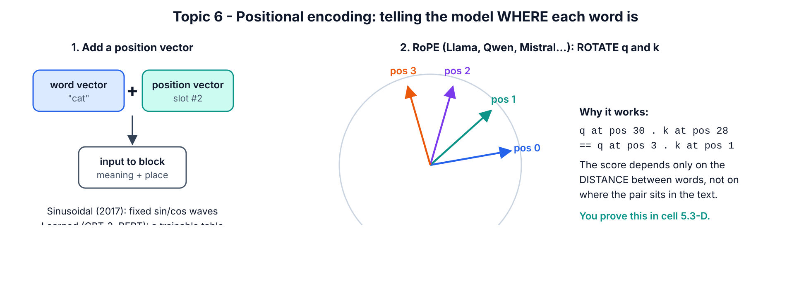

### SECTION 5.3.1 — Prove attention is blind to order

**WHERE:** same notebook  
**GOAL:** Show that shuffling inputs only shuffles outputs.

**Step 1.** Click **+ Code**.

**Step 2.** Paste cell **5.3-A**:


```python
torch.manual_seed(0)
x = torch.randn(1, 5, 32)
perm = torch.tensor([4, 2, 0, 3, 1])
y, _ = mha(x)
y_shuffled_input, _ = mha(x[:, perm])
print("Shuffle the words, outputs are just shuffled too:",
      torch.allclose(y[:, perm], y_shuffled_input, atol=1e-6))
print("=> without position info, 'dog bites man' == 'man bites dog' to attention")
```


**Step 3.** Press **Shift+Enter**.

> **You should see:**

```text
Shuffle the words, outputs are just shuffled too: True
=> without position info, 'dog bites man' == 'man bites dog' to attention
```


**Meaning:** `x[:, perm]` reorders the 5 tokens. The output of the shuffled input equals the shuffled output of the original — mathematically, self-attention is *permutation-equivariant*. This is also why rows 0 and 4 ("the" and "the") were identical in 4.3-A.

**CHECKPOINT:** `True`.

### SECTION 5.3.2 — Build sinusoidal positional encoding

**WHERE:** same notebook  
**GOAL:** Implement the 2017 formula and look at it.

The formula from the paper [9], for position `pos` and dimension pair `i`:

`PE(pos, 2i) = sin(pos / 10000^(2i/d_model))`  `PE(pos, 2i+1) = cos(pos / 10000^(2i/d_model))`

**Step 1.** Click **+ Code**.

**Step 2.** Paste cell **5.3-B**:


```python
def sinusoidal_pe(max_len, d_model):
    pos = torch.arange(max_len).unsqueeze(1)
    i = torch.arange(0, d_model, 2)
    freq = torch.exp(-math.log(10000.0) * i / d_model)
    pe = torch.zeros(max_len, d_model)
    pe[:, 0::2] = torch.sin(pos * freq)
    pe[:, 1::2] = torch.cos(pos * freq)
    return pe

pe = sinusoidal_pe(100, 64)
print("PE table:", tuple(pe.shape))
print("position 0, first 6 numbers:", [round(v, 3) for v in pe[0, :6].tolist()])
print("position 1, first 6 numbers:", [round(v, 3) for v in pe[1, :6].tolist()])
plt.figure(figsize=(8, 4))
plt.imshow(pe.T, aspect="auto", cmap="RdBu")
plt.xlabel("position in sentence")
plt.ylabel("embedding dimension")
plt.title("Sinusoidal positional encoding (each column = one position's 'barcode')")
plt.colorbar()
plt.show()
```


**Step 3.** Press **Shift+Enter**.

> **You should see:**

```text
PE table: (100, 64)
position 0, first 6 numbers: [0.0, 1.0, 0.0, 1.0, 0.0, 1.0]
position 1, first 6 numbers: [0.841, 0.54, 0.682, 0.732, 0.533, 0.846]
```


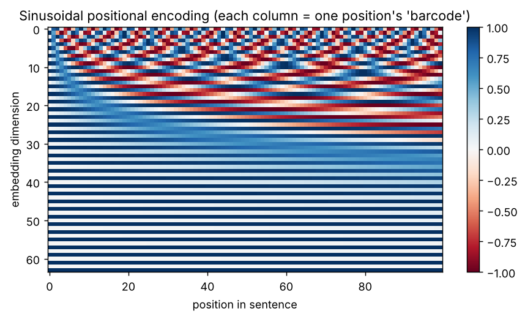

**Line by line**

- `pos` is a column `[0, 1, …, 99]`; `i` is `[0, 2, 4, …, 62]`.
- `freq = exp(−ln(10000)·i/d)` is the same as `1 / 10000^(i/d)`, written with `exp` for numerical stability. Low dimensions get high frequencies (fast waves), high dimensions get slow waves.
- `pe[:, 0::2] = sin(...)` fills even columns; `pe[:, 1::2] = cos(...)` fills odd columns.
- Position 0 is `[0, 1, 0, 1, …]` because sin(0)=0, cos(0)=1.
- In the heatmap each column is a unique "barcode" for one position. In a model you would do `x = token_embedding + pe[:T]`.

**CHECKPOINT:** table shape `(100, 64)` and the striped heatmap.

### SECTION 5.3.3 — Nearby positions look alike

**WHERE:** same notebook  
**GOAL:** Show the encoding carries a sense of distance.

**Step 1.** Click **+ Code**.

**Step 2.** Paste cell **5.3-C**:


```python
sims = pe @ pe[20]
plt.figure(figsize=(7, 3))
plt.plot(sims)
plt.axvline(20, color="red", linestyle="--")
plt.xlabel("position")
plt.ylabel("dot product with position 20")
plt.title("Nearby positions look similar, far ones look different")
plt.show()
print("similarity 20 vs 20:", round(sims[20].item(), 2))
print("similarity 20 vs 21:", round(sims[21].item(), 2))
print("similarity 20 vs 60:", round(sims[60].item(), 2))
```


**Step 3.** Press **Shift+Enter**.

> **You should see:**

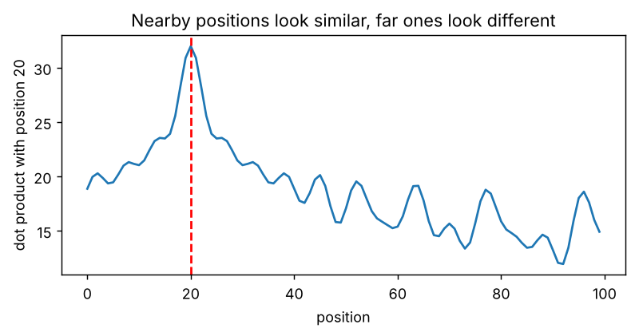


```text
similarity 20 vs 20: 32.0
similarity 20 vs 21: 30.92
similarity 20 vs 60: 15.4
```


**Meaning:** the dot product of position 20 with itself is 32 (= 64/2, since sin²+cos² = 1 for each of the 32 pairs). Position 21 is nearly as similar (30.9); position 60 is much less similar (15.4). The model can use this to tell "near" from "far".

**CHECKPOINT:** the curve peaks at the red line and falls away on both sides.

### SECTION 5.3.4 — Build RoPE and prove it encodes *relative* distance

**WHERE:** same notebook  
**GOAL:** Implement rotary position embedding and verify its key property.

**Step 1.** Click **+ Code**.

**Step 2.** Paste cell **5.3-D**:


```python
def rope(x, base=10000.0):
    T, D = x.shape[-2], x.shape[-1]
    pos = torch.arange(T, dtype=torch.float32).unsqueeze(1)
    freq = base ** (-torch.arange(0, D, 2, dtype=torch.float32) / D)
    angle = pos * freq
    cos, sin = angle.cos(), angle.sin()
    x1, x2 = x[..., 0::2], x[..., 1::2]
    out = torch.empty_like(x)
    out[..., 0::2] = x1 * cos - x2 * sin
    out[..., 1::2] = x1 * sin + x2 * cos
    return out

torch.manual_seed(0)
q_vec, k_vec = torch.randn(64), torch.randn(64)
Qs = rope(q_vec.repeat(50, 1))
Ks = rope(k_vec.repeat(50, 1))
print("query at 3, key at 1  (distance 2):", round((Qs[3] @ Ks[1]).item(), 4))
print("query at 30, key at 28 (distance 2):", round((Qs[30] @ Ks[28]).item(), 4))
print("query at 30, key at 10 (distance 20):", round((Qs[30] @ Ks[10]).item(), 4))
print("RoPE keeps vector length:", torch.allclose(Qs.norm(dim=-1), q_vec.norm().repeat(50)))
```


**Step 3.** Press **Shift+Enter**.

> **You should see:**

```text
query at 3, key at 1  (distance 2): -10.1427
query at 30, key at 28 (distance 2): -10.1427
query at 30, key at 10 (distance 20): -14.1193
RoPE keeps vector length: True
```


**Line by line**

- RoPE treats each pair of numbers `(x1, x2)` as a 2-D point and **rotates** it by `angle = position × freq`. The rotation formula is the standard one: `(x1·cos − x2·sin, x1·sin + x2·cos)`.
- It is applied to **queries and keys only** (not values), *inside* attention, instead of adding anything to the embeddings.
- Because rotating q by angle *a* and k by angle *b* gives a dot product that depends only on *a − b*, the score depends only on the **distance** between tokens: query 3 vs key 1 scores exactly the same as query 30 vs key 28 (−10.1427). Distance 20 gives a different score.
- Rotation never changes a vector's length, so RoPE does not distort the token's content.

**CHECKPOINT:** the two "distance 2" lines show the same number.

**Common mistake at this level — adding positions twice or in the wrong place.**
RoPE is applied to Q and K inside each attention layer; sinusoidal/learned PE is added once to the input embeddings. Mixing them up (e.g. adding a learned PE *and* RoPE by accident, or applying RoPE to V) still trains but wastes capacity. *How to spot it:* read the model's config (`rope_theta`, `max_position_embeddings`) and its forward code before modifying it.

---

## 5.4 Putting it together — one Transformer block

**Concept.** A **block** = multi-head attention (tokens exchange information) + a feed-forward MLP (each token processes what it gathered), each wrapped in **LayerNorm** and a **residual** ("skip") connection: `x = x + Attention(LN(x))`, then `x = x + MLP(LN(x))`. Putting the LayerNorm *before* each sub-layer ("pre-norm") trains far more stably than the original 2017 "post-norm" [46]; every modern model does it. Blocks keep the shape `(B, T, d_model)`, so you can stack as many as you like.

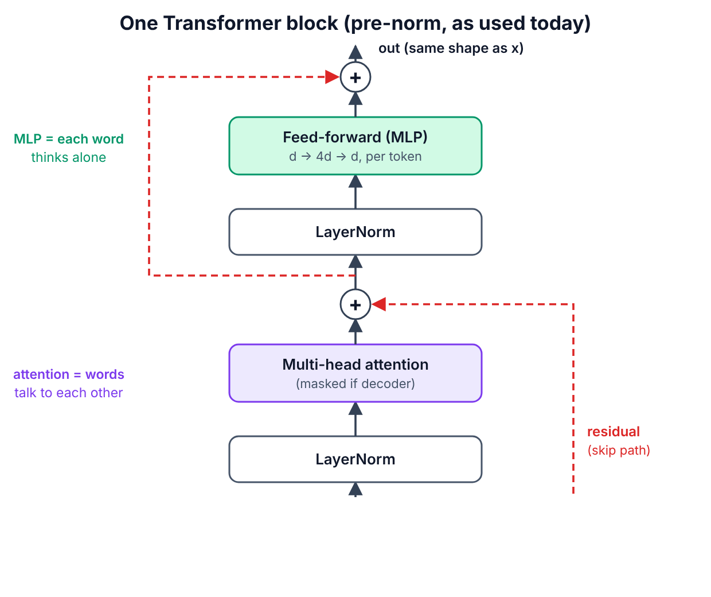

### SECTION 5.4.1 — Build `FeedForward` and `Block`

**WHERE:** same notebook  
**GOAL:** The reusable block for Part 6.

**Step 1.** Click **+ Code**.

**Step 2.** Paste cell **5.4-A**:


```python
class FeedForward(nn.Module):
    def __init__(self, d_model, dropout=0.0):
        super().__init__()
        self.net = nn.Sequential(
            nn.Linear(d_model, 4 * d_model),
            nn.GELU(),
            nn.Linear(4 * d_model, d_model),
            nn.Dropout(dropout),
        )

    def forward(self, x):
        return self.net(x)


class Block(nn.Module):
    def __init__(self, d_model, n_heads, dropout=0.0):
        super().__init__()
        self.ln1 = nn.LayerNorm(d_model)
        self.attn = MultiHeadAttention(d_model, n_heads, dropout)
        self.ln2 = nn.LayerNorm(d_model)
        self.ffn = FeedForward(d_model, dropout)

    def forward(self, x, mask=None):
        a, _ = self.attn(self.ln1(x), mask=mask)
        x = x + a
        x = x + self.ffn(self.ln2(x))
        return x

block = Block(d_model=64, n_heads=4)
x = torch.randn(2, 10, 64)
y = block(x, mask=causal_mask(10))
print("block in :", tuple(x.shape))
print("block out:", tuple(y.shape))
print("block parameters:", sum(p.numel() for p in block.parameters()))
```


**Step 3.** Press **Shift+Enter**.

> **You should see:**

```text
block in : (2, 10, 64)
block out: (2, 10, 64)
block parameters: 49984
```


**Line by line**

- `FeedForward`: expand to `4 × d_model`, apply GELU (a smooth ReLU), shrink back. It runs on every token **separately** — no mixing between tokens here.
- `x = x + a` — the residual connection. Gradients can flow straight through the `+`, which is why 100-layer models train at all.
- `self.ln1(x)` normalises each token vector to mean 0 / variance 1 before attention.
- Parameter count: attention 4 × (64·64+64) = 16,640; MLP 64·256+256 + 256·64+64 = 33,088; two LayerNorms 2 × 128 = 256 → **49,984**. The MLP holds about **2/3 of a block's parameters** — true for real LLMs too.

**CHECKPOINT:** input and output shapes are both `(2, 10, 64)`. Click **File > Save**.

**Level-up check (Part 5 done):** you have hand-built, verified versions of multi-head attention, causal and padding masks, sinusoidal PE, RoPE, and a full pre-norm Transformer block. Part 6 stacks these into complete models.


# PART 6 — ADVANCED (Topics 7, 8, 9, 10)

You now wire blocks into the three families. You will (a) use real pretrained models of each family, (b) **train your own decoder-only GPT** from scratch, and (c) **build an encoder–decoder with cross-attention** from scratch and *watch* the cross-attention work.

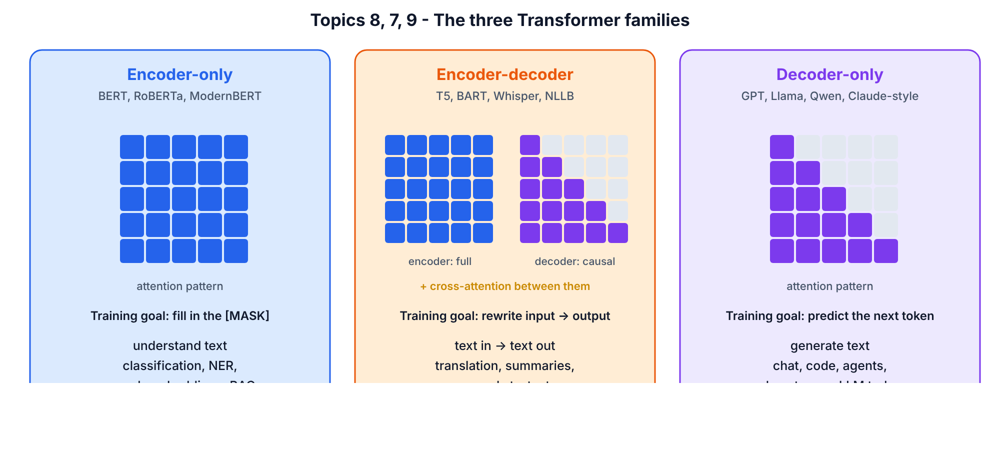

## SECTION 6.0 — Create the Part 6 notebook and paste the building blocks

**WHERE:** Google Colab  
**GOAL:** Fresh GPU notebook containing the Part 5 classes.

**Step 1.** Click **File > New notebook in Drive**.

**Step 2.** Rename it to `T101_Part6_Advanced.ipynb`.

**Step 3.** Click **Runtime > Change runtime type**, choose **T4 GPU**, click **Save**. (Part 6 trains models — use the GPU.)

**Step 4.** Click **+ Code**.

**Step 5.** Paste cell **6.0-A**:


```python
import math
import time
import torch
import torch.nn as nn
import torch.nn.functional as F
import matplotlib.pyplot as plt

torch.manual_seed(42)
device = "cuda" if torch.cuda.is_available() else "cpu"
print("torch", torch.__version__, "| device:", device)
```


**Step 6.** Press **Shift+Enter**.

> **You should see:** `torch 2.x.x+cu12x | device: cuda`

**Step 7.** Click **+ Code**.

**Step 8.** Paste cell **6.0-B** (the exact classes you built and tested in Part 5 — a new notebook does not remember old notebooks):


```python
class MultiHeadAttention(nn.Module):
    def __init__(self, d_model, n_heads, dropout=0.0):
        super().__init__()
        assert d_model % n_heads == 0
        self.n_heads = n_heads
        self.d_head = d_model // n_heads
        self.W_q = nn.Linear(d_model, d_model)
        self.W_k = nn.Linear(d_model, d_model)
        self.W_v = nn.Linear(d_model, d_model)
        self.W_o = nn.Linear(d_model, d_model)
        self.dropout = nn.Dropout(dropout)

    def split_heads(self, x):
        B, T, _ = x.shape
        return x.view(B, T, self.n_heads, self.d_head).transpose(1, 2)

    def forward(self, x_q, x_kv=None, mask=None):
        if x_kv is None:
            x_kv = x_q
        Q = self.split_heads(self.W_q(x_q))
        K = self.split_heads(self.W_k(x_kv))
        V = self.split_heads(self.W_v(x_kv))
        scores = Q @ K.transpose(-2, -1) / math.sqrt(self.d_head)
        if mask is not None:
            scores = scores.masked_fill(mask == 0, float("-inf"))
        weights = self.dropout(torch.softmax(scores, dim=-1))
        out = weights @ V
        B, H, T, Dh = out.shape
        out = out.transpose(1, 2).contiguous().view(B, T, H * Dh)
        return self.W_o(out), weights


def causal_mask(T):
    return torch.tril(torch.ones(T, T)).view(1, 1, T, T)


class FeedForward(nn.Module):
    def __init__(self, d_model, dropout=0.0):
        super().__init__()
        self.net = nn.Sequential(
            nn.Linear(d_model, 4 * d_model),
            nn.GELU(),
            nn.Linear(4 * d_model, d_model),
            nn.Dropout(dropout),
        )

    def forward(self, x):
        return self.net(x)


class Block(nn.Module):
    def __init__(self, d_model, n_heads, dropout=0.0):
        super().__init__()
        self.ln1 = nn.LayerNorm(d_model)
        self.attn = MultiHeadAttention(d_model, n_heads, dropout)
        self.ln2 = nn.LayerNorm(d_model)
        self.ffn = FeedForward(d_model, dropout)

    def forward(self, x, mask=None):
        a, _ = self.attn(self.ln1(x), mask=mask)
        x = x + a
        x = x + self.ffn(self.ln2(x))
        return x

print("building blocks ready")
```


**Step 9.** Press **Shift+Enter**.

> **You should see:**

```text
building blocks ready
```


**CHECKPOINT:** `device: cuda` and `building blocks ready`.
*If you see* `device: cpu`: redo Step 3. Everything still works on CPU, but Section 6.3 training will take ~30–60 minutes instead of a few.

---

## 6.1 Topic 7 — Encoder–decoder Transformers

**Concept.** The original 2017 Transformer [9] has two stacks. The **encoder** reads the whole input with *unmasked* self-attention and produces one context-rich vector per input token (the "memory"). The **decoder** writes the output one token at a time using (1) *masked* self-attention over what it has written so far, (2) **cross-attention** into the encoder's memory, (3) an MLP. Use it when the output is a *transformation* of a separate input: translation, summarisation, speech-to-text (Whisper [45]), T5 [13], BART.

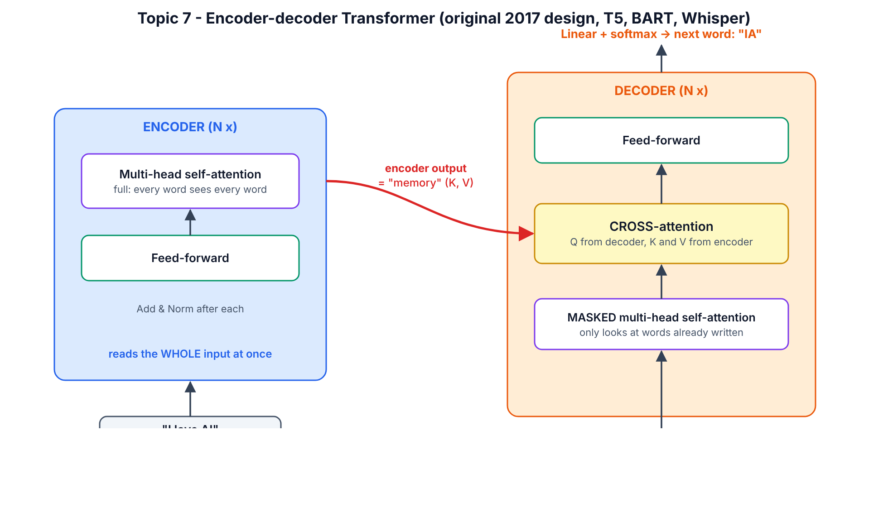

### SECTION 6.1.1 — Use a real encoder–decoder (T5)

**WHERE:** Colab, `T101_Part6_Advanced.ipynb`  
**GOAL:** Translate and summarise with T5-small (60 M parameters).

**Step 1.** Click **+ Code**.

**Step 2.** Paste cell **6.1-A**:


```python
from transformers import AutoTokenizer, AutoModelForSeq2SeqLM

t5_tok = AutoTokenizer.from_pretrained("google-t5/t5-small")
t5 = AutoModelForSeq2SeqLM.from_pretrained("google-t5/t5-small").to(device)

def t5_run(prompt, max_new_tokens=40):
    inputs = t5_tok(prompt, return_tensors="pt").to(device)
    out = t5.generate(**inputs, max_new_tokens=max_new_tokens)
    return t5_tok.decode(out[0], skip_special_tokens=True)

print(t5_run("translate English to German: The house is wonderful."))
print(t5_run("summarize: The Transformer is a neural network that reads a whole sentence at "
             "once and uses attention to decide which words matter for each other word. It "
             "replaced recurrent networks in translation and now powers chatbots."))
```


**Step 3.** Press **Shift+Enter**.

> **You should see:**

```text
Das Haus ist wunderbar.
the Transformer is a neural network that reads a whole sentence at once. it replaced recurrent networks in translation and now powers chatbots.
```


**Line by line**

- `AutoModelForSeq2SeqLM` loads an encoder–decoder model with a language-model head on the decoder.
- T5 was trained with a **task prefix** in the input text (`translate English to German:`, `summarize:`) — one model, many tasks.
- `t5.generate(...)` runs the encoder **once** on the input, then calls the decoder repeatedly, feeding back each new token, until it emits the end token or hits `max_new_tokens`.

**CHECKPOINT:** the German sentence is `Das Haus ist wunderbar.`

### SECTION 6.1.2 — Find the cross-attention inside T5

**WHERE:** same notebook  
**GOAL:** See the three sub-layers of a real decoder layer.

**Step 1.** Click **+ Code**.

**Step 2.** Paste cell **6.1-B**:


```python
cfg = t5.config
print("encoder layers:", cfg.num_layers, "| decoder layers:", cfg.num_decoder_layers,
      "| d_model:", cfg.d_model, "| heads:", cfg.num_heads)
print("\nInside ONE decoder layer:")
for name, module in t5.decoder.block[0].named_children():
    print(" ", name)
    for sub_name, sub in module.named_children():
        print("     ", sub_name, "->", type(sub).__name__)
print("\nTotal parameters:", f"{sum(p.numel() for p in t5.parameters()):,}")
```


**Step 3.** Press **Shift+Enter**.

> **You should see:**

```text
encoder layers: 6 | decoder layers: 6 | d_model: 512 | heads: 8

Inside ONE decoder layer:
  layer
      0 -> T5LayerSelfAttention
      1 -> T5LayerCrossAttention
      2 -> T5LayerFF

Total parameters: 60,506,624
```


**Meaning:** every T5 decoder layer is exactly the diagram: `T5LayerSelfAttention` (masked) → `T5LayerCrossAttention` (looks at the encoder) → `T5LayerFF` (MLP). Encoder layers have only self-attention + FF. You will build this exact structure yourself in Section 6.4.

**CHECKPOINT:** you can point to `T5LayerCrossAttention` in the printout.

**Common mistake — feeding the wrong thing to an encoder–decoder.** Beginners pass the *target* text to the encoder, or forget the task prefix for T5. *How to spot it:* output repeats the input or is empty. Rule: input text → encoder; the decoder starts from its special start token and only sees what it has generated.

---

## 6.2 Topic 8 — Encoder-only Transformers

**Concept.** Keep only the encoder stack: no causal mask, so **every token sees every other token in both directions**. It cannot naturally write text, but it produces the best *understanding* vectors. It is trained by hiding ~15% of tokens and predicting them (**masked language modelling**, BERT [11]). Use it for classification, named-entity recognition, and — most commercially important — **embedding models for semantic search and RAG** (sentence-transformers, ModernBERT [44]).

### SECTION 6.2.1 — Fill in a masked word (BERT)

**WHERE:** same notebook  
**GOAL:** Watch BERT use context on **both** sides of a gap.

**Step 1.** Click **+ Code**.

**Step 2.** Paste cell **6.2-A**:


```python
from transformers import pipeline

fill = pipeline("fill-mask", model="google-bert/bert-base-uncased",
                device=0 if device == "cuda" else -1)
for guess in fill("The [MASK] barked at the mailman all morning.")[:5]:
    print(f"{guess['token_str']:>10}  {guess['score']:.3f}")
```


**Step 3.** Press **Shift+Enter**.

> **You should see** (the model reads "barked" and "mailman" — words *after* the gap — to guess "dog"):

```text
       dog  0.285
       man  0.092
      dogs  0.033
     woman  0.027
       boy  0.026
```


**Line by line:** `pipeline("fill-mask", ...)` wraps tokenizer + model + decoding. `[MASK]` is BERT's special hidden-word token. Each result has the guessed token and its probability. A decoder-only model reading left-to-right could not use "barked" when filling a gap that comes before it.

**CHECKPOINT:** `dog` is the top answer.

### SECTION 6.2.2 — Contextual embeddings: same word, different meaning

**WHERE:** same notebook  
**GOAL:** Prove the vector for "bank" changes with its context (static embeddings from Topic 1 cannot do this).

**Step 1.** Click **+ Code**.

**Step 2.** Paste cell **6.2-B**:


```python
from transformers import AutoModel

bert_tok = AutoTokenizer.from_pretrained("google-bert/bert-base-uncased")
bert = AutoModel.from_pretrained("google-bert/bert-base-uncased").to(device).eval()

def word_vector(sentence, word):
    enc = bert_tok(sentence, return_tensors="pt").to(device)
    with torch.no_grad():
        hidden = bert(**enc).last_hidden_state[0]
    toks = bert_tok.convert_ids_to_tokens(enc["input_ids"][0])
    return hidden[toks.index(word)]

river1 = word_vector("We sat on the bank of the river and fished.", "bank")
river2 = word_vector("The river bank was muddy after the rain.", "bank")
money = word_vector("I deposited my salary at the bank today.", "bank")
print("river bank vs river bank:", round(F.cosine_similarity(river1, river2, dim=0).item(), 3))
print("river bank vs money bank:", round(F.cosine_similarity(river1, money, dim=0).item(), 3))
```


**Step 3.** Press **Shift+Enter**.

> **You should see:**

```text
river bank vs river bank: 0.66
river bank vs money bank: 0.484
```


**Line by line:** `last_hidden_state[0]` holds one 768-number vector per token *after* 12 layers of bidirectional self-attention. We pick the vector at the position of `bank`. The two "river" banks are more similar to each other than to the "money" bank — the encoder has used the surrounding words to separate the two meanings. This is the step from Topic 1's *static* embeddings to *contextual* embeddings.

**CHECKPOINT:** river-vs-river similarity is higher than river-vs-money.

### SECTION 6.2.3 — A 10-line semantic search engine (the core of RAG)

**WHERE:** same notebook  
**GOAL:** Rank documents by meaning, not keywords.

**Step 1.** Click **+ Code**.

**Step 2.** Paste cell **6.2-C**:


```python
st_name = "sentence-transformers/all-MiniLM-L6-v2"
st_tok = AutoTokenizer.from_pretrained(st_name)
st_model = AutoModel.from_pretrained(st_name).to(device).eval()

def embed(sentences):
    enc = st_tok(sentences, padding=True, truncation=True, return_tensors="pt").to(device)
    with torch.no_grad():
        hidden = st_model(**enc).last_hidden_state
    m = enc["attention_mask"].unsqueeze(-1).float()
    vecs = (hidden * m).sum(1) / m.sum(1)
    return F.normalize(vecs, dim=-1)

docs = ["How do I reset my password?",
        "Our office is closed on public holidays.",
        "Refunds are processed within 5 business days.",
        "The GPU ran out of memory during training."]
query = "I forgot my login credentials"
scores = embed([query]) @ embed(docs).T
for d, s in sorted(zip(docs, scores[0].tolist()), key=lambda p: -p[1]):
    print(f"{s:.3f}  {d}")
```


**Step 3.** Press **Shift+Enter**.

> **You should see:**

```text
0.678  How do I reset my password?
0.109  The GPU ran out of memory during training.
0.085  Refunds are processed within 5 business days.
0.072  Our office is closed on public holidays.
```


**Line by line**

- `all-MiniLM-L6-v2` is a small encoder-only model fine-tuned so that sentences with the same meaning get similar vectors.
- `padding=True` pads shorter sentences; `attention_mask` (1 = real token, 0 = PAD) is the **padding mask** from Topic 5.
- `(hidden * m).sum(1) / m.sum(1)` = **mean pooling**: average the token vectors, ignoring padding.
- `F.normalize` makes each vector length 1, so a dot product equals cosine similarity.
- The query shares **no keywords** with "How do I reset my password?" yet scores 0.68 vs ≤0.11 for the rest. That is how RAG systems find the right document chunk before an LLM answers.

**CHECKPOINT:** the password document is ranked first.

**Common mistake — using a decoder LLM's raw hidden states as search embeddings.** They are not trained for similarity and give poor retrieval. *How to spot it:* relevant documents rank randomly. Use a model trained for embeddings (sentence-transformers, BGE, E5, Qwen3-Embedding, etc.) and mean pooling or the model's documented pooling.

---

## 6.3 Topic 9 — Decoder-only Transformers

**Concept.** Keep only the decoder stack, **without** cross-attention: token embeddings + positions → N blocks of *masked* self-attention + MLP → a linear "LM head" that scores every vocabulary token as the next token. Training is trivially simple — predict the next token everywhere in huge amounts of text — and the same model can then do almost any task by continuing a prompt. GPT-2/3/4, Llama, Qwen, Mistral, DeepSeek and Claude-style models are all decoder-only. You will now build and train one.

### SECTION 6.3.1 — Load the data

**WHERE:** same notebook  
**GOAL:** Download Tiny Shakespeare (1.1 MB of plays) and turn it into numbers.

**Step 1.** Click **+ Code**.

**Step 2.** Paste cell **6.3-A**:


```python
import urllib.request

url = "https://raw.githubusercontent.com/karpathy/char-rnn/master/data/tinyshakespeare/input.txt"
text = urllib.request.urlopen(url).read().decode("utf-8")
chars = sorted(set(text))
vocab_size = len(chars)
stoi = {c: i for i, c in enumerate(chars)}
itos = {i: c for c, i in stoi.items()}
encode = lambda s: [stoi[c] for c in s]
decode = lambda ids: "".join(itos[i] for i in ids)
data = torch.tensor(encode(text), dtype=torch.long)
n = int(0.9 * len(data))
train_data, val_data = data[:n], data[n:]
print("characters in file:", f"{len(text):,}")
print("vocabulary size   :", vocab_size)
print("train / val tokens:", f"{len(train_data):,}", "/", f"{len(val_data):,}")
print(text[:120])
```


**Step 3.** Press **Shift+Enter**.

> **You should see:**

```text
characters in file: 1,115,394
vocabulary size   : 65
train / val tokens: 1,003,854 / 111,540
First Citizen:
Before we proceed any further, hear me speak.

All:
Speak, speak.

First Citizen:
You are all resolved ra
```


**Line by line:** we use a **character-level** tokenizer: every distinct character (65 of them — letters, punctuation, space, newline) is a token. `encode`/`decode` convert between text and IDs. 90% of the text trains the model; the last 10% is held out (**validation**) to check it is learning patterns, not memorising.

**CHECKPOINT:** vocabulary size `65`.

### SECTION 6.3.2 — Make training batches

**WHERE:** same notebook  
**GOAL:** Random chunks of 128 characters, with targets shifted by one.

**Step 1.** Click **+ Code**.

**Step 2.** Paste cell **6.3-B**:


```python
BLOCK_SIZE = 128
BATCH_SIZE = 64

def get_batch(split):
    src = train_data if split == "train" else val_data
    ix = torch.randint(len(src) - BLOCK_SIZE - 1, (BATCH_SIZE,))
    x = torch.stack([src[i:i + BLOCK_SIZE] for i in ix])
    y = torch.stack([src[i + 1:i + BLOCK_SIZE + 1] for i in ix])
    return x.to(device), y.to(device)

xb, yb = get_batch("train")
print("x batch:", tuple(xb.shape), " y batch:", tuple(yb.shape))
print("x:", repr(decode(xb[0, :20].tolist())))
print("y:", repr(decode(yb[0, :20].tolist())), "<- same text shifted left by one")
```


**Step 3.** Press **Shift+Enter**.

> **You should see** (your random text will differ):

```text
x batch: (64, 128)  y batch: (64, 128)
x: ' passage.\n\nSecond Wa'
y: 'passage.\n\nSecond Wat' <- same text shifted left by one
```


**Meaning:** `y` is `x` moved one character left. At every position *t* the model sees characters 0…t and must predict character t+1. One 128-character chunk therefore gives **128 training examples at once** — this is why decoder-only training is so efficient, and it only works because of the causal mask.

**CHECKPOINT:** both shapes are `(64, 128)` and the `y` text equals the `x` text shifted by one.

### SECTION 6.3.3 — Build MiniGPT

**WHERE:** same notebook  
**GOAL:** A complete decoder-only Transformer (~3.2 M parameters).

**Step 1.** Click **+ Code**.

**Step 2.** Paste cell **6.3-C**:


```python
class MiniGPT(nn.Module):
    def __init__(self, vocab_size, block_size, d_model=256, n_heads=4, n_layers=4, dropout=0.1):
        super().__init__()
        self.block_size = block_size
        self.tok_emb = nn.Embedding(vocab_size, d_model)
        self.pos_emb = nn.Embedding(block_size, d_model)
        self.drop = nn.Dropout(dropout)
        self.blocks = nn.ModuleList([Block(d_model, n_heads, dropout) for _ in range(n_layers)])
        self.ln_f = nn.LayerNorm(d_model)
        self.head = nn.Linear(d_model, vocab_size, bias=False)
        self.register_buffer("mask", causal_mask(block_size))

    def forward(self, idx, targets=None):
        B, T = idx.shape
        pos = torch.arange(T, device=idx.device)
        x = self.drop(self.tok_emb(idx) + self.pos_emb(pos))
        mask = self.mask[:, :, :T, :T]
        for block in self.blocks:
            x = block(x, mask)
        logits = self.head(self.ln_f(x))
        loss = None
        if targets is not None:
            loss = F.cross_entropy(logits.view(-1, logits.size(-1)), targets.view(-1))
        return logits, loss

    @torch.no_grad()
    def generate(self, idx, max_new_tokens, temperature=1.0, top_k=None):
        for _ in range(max_new_tokens):
            idx_cond = idx[:, -self.block_size:]
            logits, _ = self(idx_cond)
            logits = logits[:, -1, :] / temperature
            if top_k is not None:
                v, _ = torch.topk(logits, top_k)
                logits[logits < v[:, [-1]]] = float("-inf")
            probs = F.softmax(logits, dim=-1)
            next_id = torch.multinomial(probs, num_samples=1)
            idx = torch.cat([idx, next_id], dim=1)
        return idx

torch.manual_seed(42)
model = MiniGPT(vocab_size, BLOCK_SIZE).to(device)
print("MiniGPT parameters:", f"{sum(p.numel() for p in model.parameters()):,}")
_, loss = model(xb, yb)
print("loss before training:", round(loss.item(), 3), "| random-guess loss = ln(65) =", round(math.log(vocab_size), 3))
```


**Step 3.** Press **Shift+Enter**.

> **You should see:**

```text
MiniGPT parameters: 3,225,600
loss before training: 4.31 | random-guess loss = ln(65) = 4.174
```


**Line by line**

- `tok_emb` = Topic 1; `pos_emb` = learned positional encoding (Topic 6, GPT-2 style).
- `self.blocks` = 4 × your Part 5 `Block` (Topics 3–5).
- `register_buffer("mask", ...)` stores the causal mask with the model so it moves to the GPU with `.to(device)`, but it is not a trainable parameter.
- `self.mask[:, :, :T, :T]` crops the mask when the input is shorter than 128.
- `ln_f` + `head`: final LayerNorm, then a Linear layer that outputs 65 scores (**logits**) per position.
- `F.cross_entropy` compares the logits with the true next characters. `view(-1, ...)` flattens batch × time into one long list.
- `generate`: repeatedly (1) crop to the last 128 tokens, (2) run the model, (3) take the **last** position's logits, (4) divide by `temperature` (lower = safer, higher = more random), (5) optional `top_k` keeps only the k likeliest characters, (6) sample one with `torch.multinomial`, (7) append and repeat.
- Before training, loss ≈ ln(65) = 4.17 — the model is guessing uniformly at random. Good sanity check.

**CHECKPOINT:** `MiniGPT parameters: 3,225,600` and initial loss near 4.2.

### SECTION 6.3.4 — Train it

**WHERE:** same notebook, T4 GPU  
**GOAL:** Bring validation loss from ~4.2 down to ~1.5–1.7.

**Step 1.** Click **+ Code**.

**Step 2.** Paste cell **6.3-D**:


```python
MAX_ITERS = 3000
EVAL_EVERY = 300
EVAL_ITERS = 50
LR = 1e-3

@torch.no_grad()
def estimate_loss(m):
    m.eval()
    out = {}
    for split in ["train", "val"]:
        losses = torch.zeros(EVAL_ITERS)
        for k in range(EVAL_ITERS):
            x, y = get_batch(split)
            _, l = m(x, y)
            losses[k] = l.item()
        out[split] = losses.mean().item()
    m.train()
    return out

optimizer = torch.optim.AdamW(model.parameters(), lr=LR)
history = []
t0 = time.time()
for it in range(MAX_ITERS + 1):
    if it % EVAL_EVERY == 0:
        l = estimate_loss(model)
        history.append((it, l["train"], l["val"]))
        print(f"step {it:5d} | train {l['train']:.3f} | val {l['val']:.3f} | {time.time() - t0:6.1f}s")
    if it == MAX_ITERS:
        break
    x, y = get_batch("train")
    _, loss = model(x, y)
    optimizer.zero_grad(set_to_none=True)
    loss.backward()
    torch.nn.utils.clip_grad_norm_(model.parameters(), 1.0)
    optimizer.step()

steps, tr, va = zip(*history)
plt.figure(figsize=(6, 3.5))
plt.plot(steps, tr, label="train")
plt.plot(steps, va, label="val")
plt.xlabel("step")
plt.ylabel("loss")
plt.legend()
plt.title("MiniGPT learning Shakespeare")
plt.show()
```


**Step 3.** Press **Shift+Enter**.

**Step 4.** Wait. A line is printed every 300 steps.

> **You should see** (T4 GPU, about 3–6 minutes): `step 0` near 4.3, falling fast to ~1.9 by step 300, then slowly to roughly **train ≈ 1.3–1.4, val ≈ 1.5–1.6** at step 3000, followed by a plot of the two curves. Exact numbers vary run to run.
>
> For reference, here is the start of the same code on the CPU-only build machine used to test this guide (shortened to 600 steps, so it stops earlier):

```text
step     0 | train 4.315 | val 4.317 |    6.3s
step   100 | train 2.377 | val 2.394 |   93.0s
step   200 | train 2.023 | val 2.087 |  189.4s
step   300 | train 1.825 | val 1.941 |  276.9s
step   400 | train 1.697 | val 1.840 |  374.5s
step   500 | train 1.612 | val 1.779 |  459.7s
step   600 | train 1.550 | val 1.714 |  546.7s
```


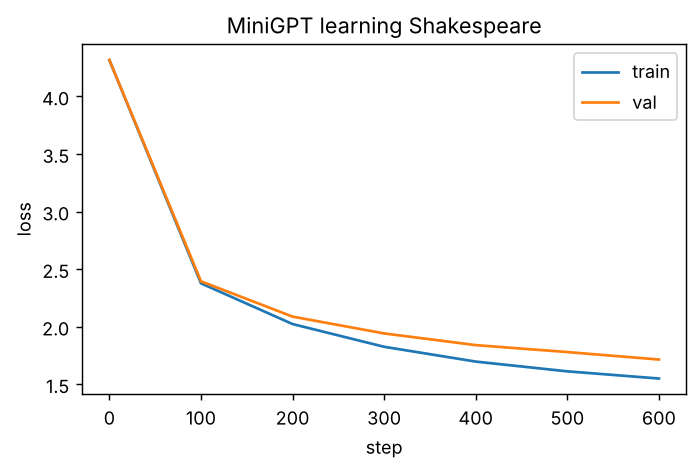

**Line by line**

- `estimate_loss` averages 50 batches for train and val, under `torch.no_grad()` (no gradients = faster) and `m.eval()` (turns dropout off).
- `AdamW` is the standard optimizer for Transformers. `lr=1e-3` is fine for a model this small; big LLMs use ~1e-4 to 3e-4 with warm-up (Part 7).
- `zero_grad → backward → clip_grad_norm_ → step` — the 5-line loop from Part 1, plus gradient clipping (caps very large updates; standard for Transformers).

| If you see... | It means... | Do this next |
|---|---|---|
| val keeps falling with train | Healthy learning | Continue |
| train ≪ val and val starts rising | Over-fitting (memorising) | Stop earlier, raise `dropout`, or use a smaller model |
| loss stuck at ~3.3 | Model only learned letter frequencies | Check the causal mask and that `y` is shifted by one |
| `CUDA out of memory` | Batch too big for the GPU | Set `BATCH_SIZE = 32`, re-run 6.3-B, 6.3-C and 6.3-D |

**CHECKPOINT:** final val loss below 1.8.

### SECTION 6.3.5 — Generate Shakespeare

**WHERE:** same notebook  
**GOAL:** Sample 300 new characters from your model.

**Step 1.** Click **+ Code**.

**Step 2.** Paste cell **6.3-E**:


```python
model.eval()
start = torch.tensor([encode("ROMEO:")], device=device)
torch.manual_seed(7)
sample = model.generate(start, max_new_tokens=300, temperature=0.8, top_k=20)
print(decode(sample[0].tolist()))
```


**Step 3.** Press **Shift+Enter**.

> **You should see** Shakespeare-*shaped* text: speaker names in capitals followed by a colon, line breaks, mostly real English words, but nonsense meaning. Example from the shortened CPU test run (yours, trained 5× longer, will look better):

```text
ROMEO:
God, my look: lord, letter your eyes
And him be my lay from out royard she have ship.

First Senate:
Spay we mader:
Why, I have father, as year that own with your
soon that yreaks of myself your and the day be day.

KING RICHARD IIII:
He scietter from where with sorms not once,
To did they it lettr
```


**CHECKPOINT:** the output contains `NAME:` lines and real words. You trained a GPT from scratch.

### SECTION 6.3.6 — Compare with a real 2026 decoder-only model (Qwen3-0.6B)

**WHERE:** same notebook (downloads ~1.5 GB)  
**GOAL:** Read a modern decoder's configuration and chat with it.

**Step 1.** Click **+ Code**.

**Step 2.** Paste cell **6.3-F**:


```python
from transformers import AutoModelForCausalLM

qwen_name = "Qwen/Qwen3-0.6B"
q_tok = AutoTokenizer.from_pretrained(qwen_name)
qwen = AutoModelForCausalLM.from_pretrained(qwen_name, dtype="auto").to(device)
c = qwen.config
print(f"layers={c.num_hidden_layers}  d_model={c.hidden_size}  query heads={c.num_attention_heads}  "
      f"key/value heads={c.num_key_value_heads}  context={c.max_position_embeddings}")
messages = [{"role": "user", "content": "In one sentence, what does a decoder-only transformer do?"}]
prompt = q_tok.apply_chat_template(messages, tokenize=False, add_generation_prompt=True,
                                   enable_thinking=False)
inputs = q_tok(prompt, return_tensors="pt").to(device)
out = qwen.generate(**inputs, max_new_tokens=60, do_sample=False)
print(q_tok.decode(out[0][inputs["input_ids"].shape[1]:], skip_special_tokens=True))
```


**Step 3.** Press **Shift+Enter**.

> **You should see:**

```text
layers=28  d_model=1024  query heads=16  key/value heads=8  context=40960
A decoder-only transformer is a type of transformer architecture that processes input sequences and outputs a sequence of outputs, typically used in tasks like text-to-text generation or sequence-to-sequence tasks.
```


**Line by line**

- `dtype="auto"` loads the weights in the precision they were saved in (bfloat16) — half the memory of float32.
- The config shows **16 query heads but only 8 key/value heads** — that is **grouped-query attention (GQA)**, which you will build in Part 7 — and a 40,960-token context.
- `apply_chat_template` wraps your message in the special tokens the model was fine-tuned with; `enable_thinking=False` switches off Qwen3's long "thinking" mode for a short answer.
- `do_sample=False` = greedy decoding (always pick the most likely token) → repeatable output.
- `out[0][inputs["input_ids"].shape[1]:]` drops the prompt tokens so only the answer is printed.

**CHECKPOINT:** a one-sentence answer.

> **Watch out (brutally honest):** the answer above is *partly wrong* — decoder-only models are not "sequence-to-sequence" in the T5 sense; they predict the next token. A 0.6 B model writes fluent, confident text with factual errors. Never trust a small model's explanation of anything important; this is why companies evaluate models and use retrieval (RAG).

**Common mistake — forgetting the chat template.** Feeding raw text to an instruction-tuned model gives rambling or broken answers. *How to spot it:* the model continues your question instead of answering it. Always use `apply_chat_template` for chat models; use raw text only for base models.

---

## 6.4 Topic 10 — Cross-attention (and building an encoder–decoder from scratch)

**Concept.** **Cross-attention** is ordinary attention where the **queries come from one sequence** (the decoder's tokens) and the **keys and values come from another** (the encoder's output). It answers "for the word I am writing now, which input positions should I read?". It is how translation models align words, how Whisper's text decoder listens to audio, how Stable-Diffusion-style image models follow a text prompt, and how multimodal LLMs read image features. In code it is your `MultiHeadAttention` with `x_kv = encoder_output`.

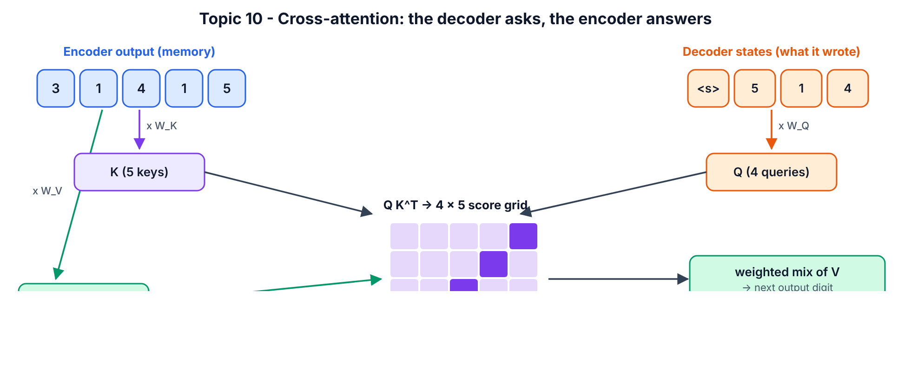

The task: give the model 8 digits, it must output them **reversed**. To succeed, decoder step 1 must read source position 8, step 2 position 7, … — so a working model *must* learn an anti-diagonal cross-attention pattern. You will see it.

### SECTION 6.4.1 — Make the toy dataset

**WHERE:** same notebook  
**GOAL:** Generate (source, decoder input, target) triples.

**Step 1.** Click **+ Code**.

**Step 2.** Paste cell **6.4-A**:


```python
SRC_LEN = 8
BOS = 10
S2S_VOCAB = 11

def make_batch(n):
    src = torch.randint(0, 10, (n, SRC_LEN))
    tgt = src.flip(1)
    dec_in = torch.cat([torch.full((n, 1), BOS), tgt[:, :-1]], dim=1)
    return src.to(device), dec_in.to(device), tgt.to(device)

s, d_in, t = make_batch(1)
print("source (encoder input)  :", s[0].tolist())
print("decoder input (BOS=10)  :", d_in[0].tolist())
print("target (what to predict):", t[0].tolist())
```


**Step 3.** Press **Shift+Enter**.

> **You should see** (your digits will differ):

```text
source (encoder input)  : [4, 9, 1, 7, 3, 2, 0, 9]
decoder input (BOS=10)  : [10, 9, 0, 2, 3, 7, 1, 9]
target (what to predict): [9, 0, 2, 3, 7, 1, 9, 4]
```


**Meaning:** tokens 0–9 are digits; token 10 is `BOS` ("begin sequence"). The decoder input is the target shifted right with BOS in front — **teacher forcing**: during training the decoder sees the *true* previous digits and learns to predict the next one.

**CHECKPOINT:** the target is the source reversed, and the decoder input is `[10]` + target without its last digit.

### SECTION 6.4.2 — Build the decoder block with cross-attention, and the full model

**WHERE:** same notebook  
**GOAL:** An encoder–decoder Transformer (~0.2 M parameters) from your own parts.

**Step 1.** Click **+ Code**.

**Step 2.** Paste cell **6.4-B**:


```python
class DecoderBlock(nn.Module):
    def __init__(self, d_model, n_heads, dropout=0.0):
        super().__init__()
        self.ln1 = nn.LayerNorm(d_model)
        self.self_attn = MultiHeadAttention(d_model, n_heads, dropout)
        self.ln2 = nn.LayerNorm(d_model)
        self.cross_attn = MultiHeadAttention(d_model, n_heads, dropout)
        self.ln3 = nn.LayerNorm(d_model)
        self.ffn = FeedForward(d_model, dropout)

    def forward(self, x, memory, tgt_mask, src_mask=None):
        a, _ = self.self_attn(self.ln1(x), mask=tgt_mask)
        x = x + a
        c, cross_w = self.cross_attn(self.ln2(x), x_kv=memory, mask=src_mask)
        x = x + c
        x = x + self.ffn(self.ln3(x))
        return x, cross_w


class Seq2SeqTransformer(nn.Module):
    def __init__(self, vocab, max_len, d_model=64, n_heads=4, n_layers=2):
        super().__init__()
        self.src_emb = nn.Embedding(vocab, d_model)
        self.tgt_emb = nn.Embedding(vocab, d_model)
        self.pos_emb = nn.Embedding(max_len, d_model)
        self.encoder = nn.ModuleList([Block(d_model, n_heads) for _ in range(n_layers)])
        self.enc_ln = nn.LayerNorm(d_model)
        self.decoder = nn.ModuleList([DecoderBlock(d_model, n_heads) for _ in range(n_layers)])
        self.dec_ln = nn.LayerNorm(d_model)
        self.head = nn.Linear(d_model, vocab)

    def encode(self, src):
        pos = torch.arange(src.size(1), device=src.device)
        x = self.src_emb(src) + self.pos_emb(pos)
        for block in self.encoder:
            x = block(x)
        return self.enc_ln(x)

    def decode(self, dec_in, memory):
        T = dec_in.size(1)
        pos = torch.arange(T, device=dec_in.device)
        x = self.tgt_emb(dec_in) + self.pos_emb(pos)
        mask = causal_mask(T).to(dec_in.device)
        for block in self.decoder:
            x, cross_w = block(x, memory, mask)
        return self.head(self.dec_ln(x)), cross_w

    def forward(self, src, dec_in):
        return self.decode(dec_in, self.encode(src))

torch.manual_seed(0)
s2s = Seq2SeqTransformer(S2S_VOCAB, SRC_LEN).to(device)
print("Seq2Seq parameters:", f"{sum(p.numel() for p in s2s.parameters()):,}")
```


**Step 3.** Press **Shift+Enter**.

> **You should see:**

```text
Seq2Seq parameters: 236,363
```


**Line by line**

- `DecoderBlock` has **three** sub-layers, exactly like T5 in 6.1.2: masked `self_attn`, then `cross_attn`, then `ffn`, each pre-normed with a residual.
- `self.cross_attn(self.ln2(x), x_kv=memory, ...)` — **this single line is cross-attention**: queries from the decoder state `x`, keys/values from the encoder output `memory`. It returns the weights so we can plot them.
- `encode()` runs the encoder blocks with **no mask** (bidirectional) and a final LayerNorm.
- `decode()` runs the decoder blocks with a causal mask; every block reads the same `memory`.
- Source and target get separate embedding tables but share a learned position table.

**CHECKPOINT:** `Seq2Seq parameters: 236,363`.

### SECTION 6.4.3 — Train it

**WHERE:** same notebook  
**GOAL:** Loss from ~2.5 to almost exactly 0 in 1,500 steps (≈40 s on the CPU test machine, faster on T4).

**Step 1.** Click **+ Code**.

**Step 2.** Paste cell **6.4-C**:


```python
opt = torch.optim.AdamW(s2s.parameters(), lr=3e-3)
for step in range(1501):
    src, dec_in, tgt = make_batch(128)
    logits, _ = s2s(src, dec_in)
    loss = F.cross_entropy(logits.reshape(-1, S2S_VOCAB), tgt.reshape(-1))
    opt.zero_grad(set_to_none=True)
    loss.backward()
    opt.step()
    if step % 300 == 0:
        print(f"step {step:4d} | loss {loss.item():.4f}")
```


**Step 3.** Press **Shift+Enter**.

> **You should see** (numbers vary slightly on GPU):

```text
step    0 | loss 2.5570
step  300 | loss 0.0005
step  600 | loss 0.0002
step  900 | loss 0.0001
step 1200 | loss 0.0001
step 1500 | loss 0.0000
```


**CHECKPOINT:** the last loss is below 0.05.

### SECTION 6.4.4 — Decode new examples (no teacher forcing)

**WHERE:** same notebook  
**GOAL:** Let the model write its own output, digit by digit, and measure accuracy.

**Step 1.** Click **+ Code**.

**Step 2.** Paste cell **6.4-D**:


```python
@torch.no_grad()
def greedy_decode(model, src):
    model.eval()
    memory = model.encode(src)
    dec = torch.full((src.size(0), 1), BOS, device=src.device)
    for _ in range(SRC_LEN):
        logits, w = model.decode(dec, memory)
        next_id = logits[:, -1].argmax(-1, keepdim=True)
        dec = torch.cat([dec, next_id], dim=1)
    return dec[:, 1:], w

src, _, tgt = make_batch(1000)
pred, _ = greedy_decode(s2s, src)
acc = (pred == tgt).all(dim=1).float().mean().item()
print("whole-sequence accuracy on 1000 new examples:", f"{acc:.1%}")
print("example source :", src[0].tolist())
print("model output   :", pred[0].tolist())
```


**Step 3.** Press **Shift+Enter**.

> **You should see:**

```text
whole-sequence accuracy on 1000 new examples: 100.0%
example source : [7, 7, 5, 0, 6, 8, 2, 2]
model output   : [2, 2, 8, 6, 0, 5, 7, 7]
```


**Line by line:** `greedy_decode` encodes the source **once**, starts the decoder with `[BOS]`, and loops 8 times: run the decoder, take the most likely next digit (`argmax`), append it. This is exactly what `t5.generate` did in 6.1.1. Accuracy counts a sequence as correct only if all 8 digits are right.

**CHECKPOINT:** accuracy above 95%.

### SECTION 6.4.5 — Look at the cross-attention

**WHERE:** same notebook  
**GOAL:** Visual proof that each output step reads the correct source position.

**Step 1.** Click **+ Code**.

**Step 2.** Paste cell **6.4-E**:


```python
example = torch.tensor([[3, 1, 4, 1, 5, 9, 2, 6]], device=device)
pred, cross_w = greedy_decode(s2s, example)
A = cross_w[0].mean(0).cpu()
plt.figure(figsize=(5, 4.5))
plt.imshow(A, cmap="viridis")
plt.xticks(range(SRC_LEN), example[0].tolist())
plt.yticks(range(SRC_LEN), pred[0].tolist())
plt.xlabel("encoder position (source digit)")
plt.ylabel("decoder step (digit being written)")
plt.title("Cross-attention: decoder looks at the source")
plt.colorbar()
plt.show()
print("output:", pred[0].tolist())
```


**Step 3.** Press **Shift+Enter**.

> **You should see:** a bright **anti-diagonal** — the first output digit looks at the last source digit, and so on:

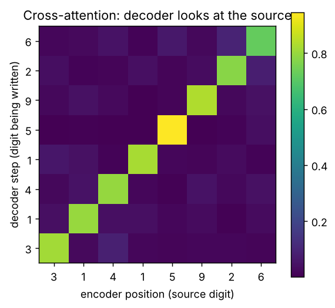


```text
output: [6, 2, 9, 5, 1, 4, 1, 3]
```


**Meaning:** nobody told the model "reverse"; it discovered that the right *alignment* is "step i reads position 7−i", and cross-attention is where that alignment lives. In translation you would see a mostly-diagonal pattern with jumps where word order differs between languages.

**CHECKPOINT:** the brightest cell in each row lies on the anti-diagonal. Click **File > Save**.

**Common mistake at this level — swapping Q and K/V in cross-attention.** If you take queries from the encoder and keys/values from the decoder, the output has the *source* length instead of the target length and the model cannot generate. *How to spot it:* a shape error when adding the residual (`x + c`), or an output of the wrong length. Rule: **Q from the side that is writing; K and V from the side being read.**

**Level-up check (Part 6 done):** you have used all three families, trained a GPT, and built cross-attention that you can see working.


# PART 7 — ELITE: how top labs and researchers build Transformers in 2026

## 7.0 What changed since 2017 — the modern recipe

Your Part 6 MiniGPT is essentially GPT-2 (2019). Every serious open model since Llama (2023) changed the same handful of parts. Interviewers at AI labs expect you to know *what* changed and *why*.

| Part | 2017 / GPT-2 (your MiniGPT) | 2023–2026 standard (Llama 3, Qwen3, Mistral, DeepSeek, Gemma) | Why it changed |
|---|---|---|---|
| Normalisation | LayerNorm, post-norm (2017) / pre-norm (GPT-2) | **RMSNorm**, pre-norm [18]; often **QK-norm** on queries/keys (Qwen3, OLMo 2) | Cheaper, equally good; QK-norm stops attention logits exploding |
| Positions | Sinusoidal / learned table | **RoPE** [14] (+ YaRN-style scaling for long context) | Relative distance, extends to longer contexts |
| MLP | Linear → ReLU/GELU → Linear | **SwiGLU** gated MLP [17] | Better quality per parameter |
| Attention heads | Full multi-head (MHA) | **GQA** [15] (Llama 3, Qwen3), **MQA** [16], **MLA** (DeepSeek-V3 [20]) | Shrinks the KV cache → cheaper long-context inference |
| Attention kernel | Plain matmul + softmax | **FlashAttention** 2/3/4 [19], PyTorch SDPA [34] | Never materialise the T×T matrix; FA4 targets NVIDIA Blackwell (Mar 2026) |
| MLP capacity | Dense: every token uses every weight | **Mixture-of-Experts** (DeepSeek-V3, Qwen3-MoE, Kimi K2) [38][20] | Huge total parameters, small active parameters per token |
| Attention span | Full attention every layer | **Sliding-window / local–global** mixes (Gemma 3, Mistral), **sparse** attention (DeepSeek-V3.2), **hybrid linear attention** (Qwen3-Next: 3 Gated DeltaNet layers per 1 gated-attention layer; Kimi Linear) [31] | Escape the T² cost for very long contexts |
| Output layer | Separate or tied to embedding | Tied in small models, untied in large | Saves parameters in small models |
| Generation | Recompute everything each step | **KV cache** (+ paged attention in vLLM) | Turns O(T²) generation into O(T) work per step |

Sebastian Raschka's *LLM Architecture Gallery* and *The Big LLM Architecture Comparison* track these choices model by model [25]; read them after this Part.

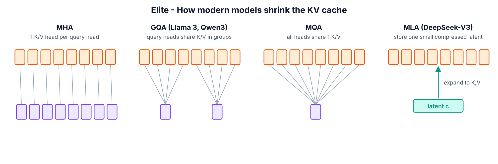

## 7.1 Who defines the top level (names to know)

| Person / org | Contribution you should be able to explain |
|---|---|
| Vaswani, Shazeer, Parmar, Uszkoreit, Jones, Gomez, Kaiser, Polosukhin (Google, 2017) | *Attention Is All You Need* — the Transformer [9] |
| Noam Shazeer | Multi-query attention [16], SwiGLU/GLU variants [17], sparsely-gated MoE |
| Jianlin Su et al. | RoPE (RoFormer) [14] |
| Tri Dao (Princeton / Together AI) | FlashAttention 1–4 [19]; with Albert Gu, Mamba state-space models [32] |
| DeepSeek | MLA + fine-grained MoE + multi-token prediction (DeepSeek-V3) [20]; sparse attention (V3.2) |
| Alibaba Qwen team | Qwen3 dense/MoE; Qwen3-Next hybrid linear + gated attention [31] |
| Anthropic interpretability (Chris Olah et al.) | *Mathematical Framework for Transformer Circuits*, **induction heads** [21][22] |
| Neel Nanda | TransformerLens library [26]; mechanistic interpretability tutorials |
| Andrej Karpathy | nanoGPT, *Let's build GPT* video, **nanochat** (full ChatGPT-style pipeline for ~$100) [24] |
| Keller Jordan et al. | **modded-nanogpt** speedrun (GPT-2-124M quality in minutes), Muon optimizer |
| Sebastian Raschka | *Build a Large Language Model (From Scratch)* + repo [25] |
| Stanford CS336 (Percy Liang, Tatsunori Hashimoto) | *Language Modeling from Scratch* course: build, scale, optimise LMs [42] |
| AI2 (OLMo) | Fully open models: data, code, checkpoints — best for research reproductions |

**How elite people actually work** (copy these habits):

1. **Read code, not only papers.** Papers omit details; the reference implementation (Hugging Face `modeling_*.py`, nanoGPT, the paper's repo) is the truth.
2. **Reproduce a baseline first, then change one thing.** Same data, same compute budget, same seed policy. Report validation loss, not vibes.
3. **Measure cost, not only quality:** tokens/second, GPU memory, KV-cache size. Most 2024–2026 architecture work is about cost.
4. **Test mechanisms directly** (interpretability): don't trust a pretty heatmap; define a score and measure it across all heads (you do this in 7.4).

---

## SECTION 7.2 — Build a "Llama/Qwen-style" decoder: RMSNorm + RoPE + SwiGLU + GQA + SDPA

**WHERE:** Google Colab — new notebook `T101_Part7_Elite.ipynb`, **T4 GPU**  
**GOAL:** Upgrade MiniGPT to the 2026 recipe and train it on the same data and budget.

**Step 1.** Click **File > New notebook in Drive**.

**Step 2.** Rename it to `T101_Part7_Elite.ipynb`.

**Step 3.** Click **Runtime > Change runtime type**, choose **T4 GPU**, click **Save**.

**Step 4.** Click **+ Code**.

**Step 5.** Paste cell **7.0-A** (imports + the same Shakespeare data pipeline as Part 6):


```python
import math
import time
import urllib.request
import torch
import torch.nn as nn
import torch.nn.functional as F
import matplotlib.pyplot as plt

torch.manual_seed(42)
device = "cuda" if torch.cuda.is_available() else "cpu"
print("torch", torch.__version__, "| device:", device)

url = "https://raw.githubusercontent.com/karpathy/char-rnn/master/data/tinyshakespeare/input.txt"
text = urllib.request.urlopen(url).read().decode("utf-8")
chars = sorted(set(text))
vocab_size = len(chars)
stoi = {c: i for i, c in enumerate(chars)}
itos = {i: c for c, i in stoi.items()}
encode = lambda s: [stoi[c] for c in s]
decode = lambda ids: "".join(itos[i] for i in ids)
data = torch.tensor(encode(text), dtype=torch.long)
n = int(0.9 * len(data))
train_data, val_data = data[:n], data[n:]

BLOCK_SIZE = 128
BATCH_SIZE = 64

def get_batch(split):
    src = train_data if split == "train" else val_data
    ix = torch.randint(len(src) - BLOCK_SIZE - 1, (BATCH_SIZE,))
    x = torch.stack([src[i:i + BLOCK_SIZE] for i in ix])
    y = torch.stack([src[i + 1:i + BLOCK_SIZE + 1] for i in ix])
    return x.to(device), y.to(device)

print("data ready:", f"{len(train_data):,}", "train tokens, vocab", vocab_size)
```


**Step 6.** Press **Shift+Enter**.

> **You should see:** `torch ... | device: cuda` then
> `data ready: 1,003,854 train tokens, vocab 65`

**Step 7.** Click **+ Code**.

**Step 8.** Paste cell **7.1-A** (the four modern components):


```python
class RMSNorm(nn.Module):
    def __init__(self, dim, eps=1e-6):
        super().__init__()
        self.eps = eps
        self.weight = nn.Parameter(torch.ones(dim))

    def forward(self, x):
        return x * torch.rsqrt(x.pow(2).mean(-1, keepdim=True) + self.eps) * self.weight


def rope_tables(max_len, d_head, base=10000.0):
    freq = base ** (-torch.arange(0, d_head, 2).float() / d_head)
    angles = torch.outer(torch.arange(max_len).float(), freq)
    return angles.cos(), angles.sin()


def apply_rope(x, cos, sin):
    x1, x2 = x[..., 0::2], x[..., 1::2]
    rotated = torch.stack([x1 * cos - x2 * sin, x1 * sin + x2 * cos], dim=-1)
    return rotated.flatten(-2)


class GQAttention(nn.Module):
    def __init__(self, d_model, n_heads, n_kv_heads):
        super().__init__()
        assert n_heads % n_kv_heads == 0
        self.h, self.kv = n_heads, n_kv_heads
        self.dh = d_model // n_heads
        self.wq = nn.Linear(d_model, n_heads * self.dh, bias=False)
        self.wk = nn.Linear(d_model, n_kv_heads * self.dh, bias=False)
        self.wv = nn.Linear(d_model, n_kv_heads * self.dh, bias=False)
        self.wo = nn.Linear(n_heads * self.dh, d_model, bias=False)

    def forward(self, x, cos, sin, cache=None):
        B, T, _ = x.shape
        q = self.wq(x).view(B, T, self.h, self.dh).transpose(1, 2)
        k = self.wk(x).view(B, T, self.kv, self.dh).transpose(1, 2)
        v = self.wv(x).view(B, T, self.kv, self.dh).transpose(1, 2)
        q, k = apply_rope(q, cos, sin), apply_rope(k, cos, sin)
        if cache is not None:
            if cache["k"] is not None:
                k = torch.cat([cache["k"], k], dim=2)
                v = torch.cat([cache["v"], v], dim=2)
            cache["k"], cache["v"] = k, v
        k = k.repeat_interleave(self.h // self.kv, dim=1)
        v = v.repeat_interleave(self.h // self.kv, dim=1)
        out = F.scaled_dot_product_attention(q, k, v, is_causal=(T > 1))
        return self.wo(out.transpose(1, 2).reshape(B, T, -1))


class SwiGLU(nn.Module):
    def __init__(self, d_model):
        super().__init__()
        hidden = 64 * math.ceil((8 * d_model / 3) / 64)
        self.w_gate = nn.Linear(d_model, hidden, bias=False)
        self.w_up = nn.Linear(d_model, hidden, bias=False)
        self.w_down = nn.Linear(hidden, d_model, bias=False)

    def forward(self, x):
        return self.w_down(F.silu(self.w_gate(x)) * self.w_up(x))


class ModernBlock(nn.Module):
    def __init__(self, d_model, n_heads, n_kv_heads):
        super().__init__()
        self.norm1 = RMSNorm(d_model)
        self.attn = GQAttention(d_model, n_heads, n_kv_heads)
        self.norm2 = RMSNorm(d_model)
        self.ffn = SwiGLU(d_model)

    def forward(self, x, cos, sin, cache=None):
        x = x + self.attn(self.norm1(x), cos, sin, cache)
        x = x + self.ffn(self.norm2(x))
        return x

print("modern building blocks ready")
```


**Step 9.** Press **Shift+Enter**.

> **You should see:**

```text
modern building blocks ready
```


**Line by line**

- **RMSNorm**: divide each vector by its root-mean-square, then scale by a learned weight. Unlike LayerNorm it does not subtract the mean and has no bias — fewer operations, same stability.
- **`rope_tables`** pre-computes cos/sin for every position once. **`apply_rope`** is the rotation you proved in 5.3-D, written with `stack(...).flatten(-2)` so it interleaves the rotated pairs back into place.
- **GQAttention**: `wq` produces `n_heads` query heads, but `wk`/`wv` produce only `n_kv_heads` (here 8 query heads, 2 KV heads). `repeat_interleave` lets each group of 4 query heads share one K/V head. Same quality idea as full MHA, ¼ of the KV memory.
- The `cache` dictionary stores past K and V (the **KV cache**, used in Section 7.3). New K/V are concatenated on the time axis (`dim=2`).
- `F.scaled_dot_product_attention(..., is_causal=(T > 1))` is PyTorch's fused attention. On Ampere/Hopper GPUs it dispatches to FlashAttention; on the T4 it uses the memory-efficient kernel. `is_causal=True` applies the causal mask without building it. With one new token (`T == 1`) no mask is needed — it may see the whole cache.
- **SwiGLU**: two parallel projections; one goes through SiLU and acts as a **gate** that multiplies the other. Hidden size ≈ 8/3 × d (rounded to 64) keeps the parameter count close to a 4× GELU MLP.
- **ModernBlock** is the same pre-norm residual pattern as Part 5, with the new parts plugged in.

**Step 10.** Click **+ Code**.

**Step 11.** Paste cell **7.1-B** (the full model):


```python
class ModernGPT(nn.Module):
    def __init__(self, vocab_size, block_size, d_model=256, n_heads=8, n_kv_heads=2,
                 n_layers=4, max_len=1024):
        super().__init__()
        self.block_size = block_size
        self.tok_emb = nn.Embedding(vocab_size, d_model)
        self.blocks = nn.ModuleList(
            [ModernBlock(d_model, n_heads, n_kv_heads) for _ in range(n_layers)])
        self.norm = RMSNorm(d_model)
        self.head = nn.Linear(d_model, vocab_size, bias=False)
        self.head.weight = self.tok_emb.weight
        cos, sin = rope_tables(max_len, d_model // n_heads)
        self.register_buffer("cos", cos, persistent=False)
        self.register_buffer("sin", sin, persistent=False)
        self.apply(self._init_weights)

    def _init_weights(self, module):
        if isinstance(module, (nn.Linear, nn.Embedding)):
            nn.init.normal_(module.weight, mean=0.0, std=0.02)

    def forward(self, idx, targets=None, caches=None, start_pos=0):
        B, T = idx.shape
        cos = self.cos[start_pos:start_pos + T]
        sin = self.sin[start_pos:start_pos + T]
        x = self.tok_emb(idx)
        for i, block in enumerate(self.blocks):
            x = block(x, cos, sin, None if caches is None else caches[i])
        logits = self.head(self.norm(x))
        loss = None
        if targets is not None:
            loss = F.cross_entropy(logits.view(-1, logits.size(-1)), targets.view(-1))
        return logits, loss

    @torch.no_grad()
    def generate(self, idx, max_new_tokens, use_cache=True):
        if not use_cache:
            for _ in range(max_new_tokens):
                logits, _ = self(idx[:, -self.block_size:])
                idx = torch.cat([idx, logits[:, -1].argmax(-1, keepdim=True)], dim=1)
            return idx
        caches = [{"k": None, "v": None} for _ in self.blocks]
        logits, _ = self(idx, caches=caches, start_pos=0)
        for _ in range(max_new_tokens):
            next_id = logits[:, -1].argmax(-1, keepdim=True)
            idx = torch.cat([idx, next_id], dim=1)
            logits, _ = self(next_id, caches=caches, start_pos=idx.size(1) - 1)
        return idx

torch.manual_seed(42)
modern = ModernGPT(vocab_size, BLOCK_SIZE).to(device)
print("ModernGPT parameters:", f"{sum(p.numel() for p in modern.parameters()):,}")
xb, yb = get_batch("train")
_, loss = modern(xb, yb)
print("loss before training:", round(loss.item(), 3))
```


**Step 12.** Press **Shift+Enter**.

> **You should see:**

```text
ModernGPT parameters: 2,836,992
loss before training: 4.225
```


**Line by line**

- There is **no `pos_emb`** — positions live entirely in RoPE inside attention.
- `self.head.weight = self.tok_emb.weight` — **weight tying**: the output layer reuses the embedding table (saves 16k parameters here, ~0.5–1 B in mid-size LLMs).
- `self.apply(self._init_weights)` starts every Linear and Embedding weight as small random numbers (standard deviation 0.02, the GPT-2 recipe). **This line matters:** while testing this guide, the model *without* it started at a loss of **237** instead of ~4.2, because PyTorch's default embedding init (std 1.0) is shared with the output layer through weight tying and produces huge logits. Initialisation is part of the architecture.
- `register_buffer(..., persistent=False)` stores the RoPE tables on the GPU without saving them in checkpoints.
- `start_pos` tells RoPE the absolute position of the first token being processed — essential when you feed one token at a time with a cache.
- `generate(use_cache=False)` re-runs the whole prefix every step (like MiniGPT). `generate(use_cache=True)` runs the prompt once ("prefill"), then feeds **only the newest token** each step ("decode") — this is how every production inference server works.

**Step 13.** Click **+ Code**.

**Step 14.** Paste cell **7.1-C** (training with modern practice):


```python
MAX_ITERS = 3000
EVAL_EVERY = 300
EVAL_ITERS = 50
use_amp = device == "cuda"

@torch.no_grad()
def estimate_loss(m):
    m.eval()
    out = {}
    for split in ["train", "val"]:
        losses = torch.zeros(EVAL_ITERS)
        for k in range(EVAL_ITERS):
            x, y = get_batch(split)
            with torch.autocast(device_type=device, dtype=torch.float16, enabled=use_amp):
                _, l = m(x, y)
            losses[k] = l.item()
        out[split] = losses.mean().item()
    m.train()
    return out

optimizer = torch.optim.AdamW(modern.parameters(), lr=1e-3, betas=(0.9, 0.95), weight_decay=0.1)
scheduler = torch.optim.lr_scheduler.OneCycleLR(optimizer, max_lr=1e-3, total_steps=MAX_ITERS,
                                                pct_start=0.1)
scaler = torch.amp.GradScaler("cuda", enabled=use_amp)
t0 = time.time()
for it in range(MAX_ITERS + 1):
    if it % EVAL_EVERY == 0:
        l = estimate_loss(modern)
        print(f"step {it:5d} | train {l['train']:.3f} | val {l['val']:.3f} | {time.time() - t0:6.1f}s")
    if it == MAX_ITERS:
        break
    x, y = get_batch("train")
    with torch.autocast(device_type=device, dtype=torch.float16, enabled=use_amp):
        _, loss = modern(x, y)
    optimizer.zero_grad(set_to_none=True)
    scaler.scale(loss).backward()
    scaler.unscale_(optimizer)
    torch.nn.utils.clip_grad_norm_(modern.parameters(), 1.0)
    scaler.step(optimizer)
    scaler.update()
    scheduler.step()
```


**Step 15.** Press **Shift+Enter** and wait (≈3–6 minutes on T4).

> **You should see:** loss lines every 300 steps, finishing around **val ≈ 1.45–1.55** on T4 after 3,000 steps. Compare with your Part 6 MiniGPT at the same step count. On the CPU build machine (both runs shortened to 600 steps) the result was **MiniGPT val 1.714 vs ModernGPT val 1.505 — with 12% fewer parameters** (2.84 M vs 3.23 M). Honest caveat: the two runs also differ in optimiser settings and LR schedule, so this is not a pure architecture ablation — fixing that is Project 2 in Part 11. Reference log from that shortened run:

```text
step     0 | train 4.227 | val 4.220 |    5.3s
step   100 | train 1.899 | val 2.003 |   66.6s
step   200 | train 1.523 | val 1.721 |  137.7s
step   300 | train 1.401 | val 1.608 |  197.0s
step   400 | train 1.320 | val 1.537 |  253.7s
step   500 | train 1.281 | val 1.516 |  311.0s
step   600 | train 1.256 | val 1.505 |  370.4s
```


**Line by line**

- `torch.autocast(..., dtype=torch.float16)` = **mixed precision**: matrix multiplies run in 16-bit (≈2× faster on T4 tensor cores, half the activation memory); sensitive operations stay 32-bit. On A100/H100 use `torch.bfloat16` and drop the scaler.
- `GradScaler` multiplies the loss before `backward()` so tiny float16 gradients don't round to zero, then un-scales before the optimizer step. `scaler.unscale_` must come before `clip_grad_norm_`.
- `AdamW(betas=(0.9, 0.95), weight_decay=0.1)` — the betas and decay used by most LLM training recipes.
- `OneCycleLR(pct_start=0.1)` = **warm-up** for the first 10% of steps, then cosine-like decay. Warm-up avoids early instability; decay squeezes out the last bit of loss.

| If you see... | It means... | Do this next |
|---|---|---|
| `loss = nan` | float16 overflow | Make sure you used `GradScaler`; or set `use_amp = False` |
| val worse than MiniGPT by > 0.1 | A bug (often RoPE or the mask) | Re-run Part 5.3-D test; check `is_causal=(T > 1)` |
| `RuntimeError ... size of tensor a (32) must match ... (16)` | `cos/sin` built with the wrong head size | `rope_tables(max_len, d_model // n_heads)` |
| loss before training is in the hundreds | Weight init missing with tied embeddings | Make sure `self.apply(self._init_weights)` is in `__init__` (7.1-B) |

**CHECKPOINT:** training finishes, final val loss < 1.8.

**Common mistake at this level — benchmarking unfairly.** Comparing two architectures with different step counts, learning rates or token budgets proves nothing. *How to spot it:* you cannot state the exact budget for each run. Elite practice: fixed tokens, tuned LR for each, ≥2 seeds.

---

## SECTION 7.3 — KV cache: measure the speed-up and the memory bill

**WHERE:** same notebook  
**GOAL:** Prove the KV cache gives identical text, measure tokens/second, then compute KV memory for real models.

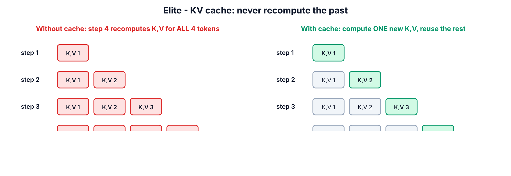

**Step 1.** Click **+ Code**.

**Step 2.** Paste cell **7.2-A**:


```python
modern.eval()
prompt = torch.tensor([encode("ROMEO:")], device=device)
N_NEW = 110

def timed(use_cache):
    if device == "cuda":
        torch.cuda.synchronize()
    t = time.time()
    out = modern.generate(prompt, N_NEW, use_cache=use_cache)
    if device == "cuda":
        torch.cuda.synchronize()
    return out, time.time() - t

modern.generate(prompt, 5, use_cache=True)
slow, t_slow = timed(use_cache=False)
fast, t_fast = timed(use_cache=True)
print("identical text with and without cache:", torch.equal(slow, fast))
print(f"no cache : {N_NEW / t_slow:7.1f} tokens/s")
print(f"KV cache : {N_NEW / t_fast:7.1f} tokens/s  ({t_slow / t_fast:.1f}x faster)")
print()
print(decode(fast[0].tolist()))
```


**Step 3.** Press **Shift+Enter**.

> **You should see** something like this (speed numbers depend on hardware; the ratio grows with longer outputs and bigger models):

```text
identical text with and without cache: True
no cache :   268.0 tokens/s
KV cache :   785.2 tokens/s  (2.9x faster)

ROMEO:
The prince of the state of the state of the state,
And then the season of the state of the state,
And therefo
```


**Line by line**

- One short warm-up call (`generate(prompt, 5)`) so first-call setup does not distort timing.
- `torch.cuda.synchronize()` — GPU work is asynchronous; without it you would time only the *launch* of the work.
- `torch.equal(slow, fast)` — greedy decoding with and without cache must give the **same** tokens. If this is `False`, your cache or RoPE offsets (`start_pos`) are wrong.
- We generate 110 tokens so the total (116) stays under the 128-token training window; beyond it the no-cache path crops context and the two would legitimately differ.
- The sample text loops ("of the state of the state…") because **greedy** decoding always picks the single most likely token; small models fall into repetition. That is why chat products sample with temperature/top-p (Part 6.3-E) — the KV cache works identically with sampling.

**Step 4.** Click **+ Code**.

**Step 5.** Paste cell **7.2-B**:


```python
def kv_cache_gb(layers, kv_heads, d_head, seq_len, batch=1, bytes_per_value=2):
    return 2 * layers * kv_heads * d_head * seq_len * batch * bytes_per_value / 1e9

print("KV cache for ONE 32k-token conversation, 16-bit values:")
print(f"  8B model, full multi-head (32 KV heads): {kv_cache_gb(32, 32, 128, 32768):5.1f} GB")
print(f"  8B model, GQA (8 KV heads)             : {kv_cache_gb(32, 8, 128, 32768):5.1f} GB")
print(f"  8B model, MQA (1 KV head)              : {kv_cache_gb(32, 1, 128, 32768):5.1f} GB")
print(f"  Qwen3-0.6B (28 layers, 8 KV heads)     : {kv_cache_gb(28, 8, 128, 32768):5.1f} GB")
```


**Step 6.** Press **Shift+Enter**.

> **You should see:**

```text
KV cache for ONE 32k-token conversation, 16-bit values:
  8B model, full multi-head (32 KV heads):  17.2 GB
  8B model, GQA (8 KV heads)             :   4.3 GB
  8B model, MQA (1 KV head)              :   0.5 GB
  Qwen3-0.6B (28 layers, 8 KV heads)     :   3.8 GB
```


**Meaning:** the formula is `2 (K and V) × layers × kv_heads × head_dim × tokens × bytes`. For an 8B-class model a single 32k-token chat needs **17 GB** of cache with full MHA but **4.3 GB** with GQA — the reason Llama 3 and Qwen3 use GQA and DeepSeek invented MLA. KV-cache size, not weights, is often what limits how many users one GPU can serve. This is a top interview question for inference/serving roles.

**CHECKPOINT:** `identical text ... True`, and the cache version is faster.

**Common mistake — forgetting position offsets with a cache.** If you apply RoPE to the new token as position 0 every step, generation slowly turns to garbage. *How to spot it:* `identical text` prints `False`. Fix: pass `start_pos = current_length - 1` (as in `generate`).

---

## SECTION 7.4 — Mechanistic interpretability: find the induction heads in GPT-2

**Concept.** Anthropic's 2022 research [21] showed that small and large Transformers develop **induction heads**: a two-layer circuit that implements "if the pattern `A B` appeared before and I now see `A` again, predict `B`". It is believed to be a core mechanism of **in-context learning** (why LLMs can copy names, follow examples in a prompt, etc.). The measurement trick: feed a sequence of **random tokens repeated twice**. On the first copy nothing is predictable; on the second copy a model with induction heads predicts almost perfectly, and those heads attend from each token to the token *right after its previous occurrence*.

**WHERE:** same notebook (downloads GPT-2 small, ~550 MB)  
**GOAL:** Measure in-context learning and score all 144 heads of GPT-2.

**Step 1.** Click **+ Code**.

**Step 2.** Paste cell **7.3-A**:


```python
from transformers import AutoTokenizer, AutoModelForCausalLM

g_tok = AutoTokenizer.from_pretrained("openai-community/gpt2")
g_model = AutoModelForCausalLM.from_pretrained(
    "openai-community/gpt2", attn_implementation="eager").to(device).eval()

torch.manual_seed(0)
L = 50
rand = torch.randint(1000, 10000, (1, L))
seq = torch.cat([torch.tensor([[g_tok.bos_token_id]]), rand, rand], dim=1).to(device)
with torch.no_grad():
    out = g_model(seq, output_attentions=True)
logp = F.log_softmax(out.logits[0, :-1].float(), dim=-1)
tok_loss = -logp.gather(1, seq[0, 1:].unsqueeze(1)).squeeze(1)
print(f"average loss on 1st copy of the random tokens: {tok_loss[:L].mean().item():.2f}")
print(f"average loss on 2nd copy of the random tokens: {tok_loss[L:].mean().item():.2f}")
```


**Step 3.** Press **Shift+Enter**.

> **You should see:**

```text
average loss on 1st copy of the random tokens: 12.27
average loss on 2nd copy of the random tokens: 0.45
```


**Line by line**

- `torch.randint(1000, 10000, (1, L))` — 50 random token IDs (avoiding the most common tokens). The full input is `[BOS] + random + random` = 101 tokens.
- `log_softmax(logits[:-1])` and `gather(seq[1:])` — the log-probability the model gave to the **actual next token** at every position; minus that is the loss per token.
- On the first copy the loss is ~10 (pure guessing among 50k tokens). On the second copy it collapses to <1: the model is copying from context it has seen only once. That is in-context learning, measured.

**Step 4.** Click **+ Code**.

**Step 5.** Paste cell **7.3-B**:


```python
att = torch.stack(out.attentions)[:, 0]
q_pos = torch.arange(L + 1, 2 * L + 1, device=device)
k_pos = q_pos - L + 1
induction = att[:, :, q_pos, k_pos].mean(-1).cpu()
plt.figure(figsize=(6, 5))
plt.imshow(induction, cmap="magma")
plt.xlabel("head")
plt.ylabel("layer")
plt.title("Induction score of every GPT-2 head")
plt.colorbar()
plt.show()
top = torch.topk(induction.flatten(), 5)
for score, flat in zip(top.values.tolist(), top.indices.tolist()):
    print(f"layer {flat // 12:2d} head {flat % 12:2d}  induction score {score:.2f}")
```


**Step 6.** Press **Shift+Enter**.

> **You should see:** a 12 × 12 heatmap with a few bright cells in the middle layers, and a ranking like:

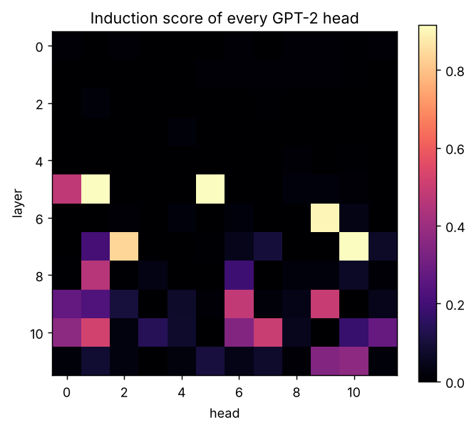


```text
layer  7 head 10  induction score 0.91
layer  5 head  1  induction score 0.91
layer  5 head  5  induction score 0.91
layer  6 head  9  induction score 0.90
layer  7 head  2  induction score 0.84
```


**Line by line**

- For a query at position `i` in the second copy, its previous occurrence is at `i − L`, so the token that came **next** last time is at `i − L + 1`. `att[:, :, q_pos, k_pos]` reads the attention from every query to exactly that key, for all layers and heads at once; `.mean(-1)` averages over the 50 positions → one **induction score** per head.
- A score near 1 means the head does almost nothing except "look at what came after my last occurrence". Heads in layers 5–7 of GPT-2 small (e.g. 5.1, 5.5, 6.9, 7.10) are the well-known induction heads found by the interpretability community — you just rediscovered them with ~15 lines of code.

**CHECKPOINT:** second-copy loss far below first-copy loss, and at least a few heads score > 0.5.

**Go further (elite):** install TransformerLens [26] (`pip install transformer_lens`) and **ablate** (zero out) your top induction heads with a hook, then re-measure the second-copy loss. If it jumps up, you have shown the heads are *causally* necessary, not just correlated — this is the standard of evidence in interpretability research.

**Common mistake at this level — off-by-one in position bookkeeping.** Using `k_pos = q_pos − L` scores "previous-occurrence" heads instead of induction heads. *How to spot it:* different heads light up and scores are lower. Write the indices out on paper for a 3-token example first.

---

## 7.5 The frontier: what to study next (and what to read)

| Direction | One-line idea | Start here |
|---|---|---|
| FlashAttention 2/3/4 | Tile Q, K, V into fast on-chip memory; never store the T×T matrix | Dao et al. [19]; FA4 paper arXiv:2603.05451 |
| Mixture-of-Experts | A router sends each token to 2–8 of many expert MLPs | Switch Transformer [38]; DeepSeek-V3 [20] |
| MLA | Compress K/V into a small latent; expand on the fly | DeepSeek-V2/V3 [20] |
| Hybrid / linear attention | Most layers use O(T) recurrent "linear attention" (DeltaNet, Mamba-2), a few keep full softmax attention | Raschka hybrid-attention gallery [25]; Qwen3-Next; Mamba [32] |
| Gated attention | A learned sigmoid gate on the attention output; removes attention sinks, stabilises training | Qiu et al. 2025, *Gated Attention for LLMs* (arXiv:2505.06708) (verify) |
| Long context | RoPE scaling (YaRN), sliding windows, sparse attention | DeepSeek-V3.2 sparse attention; Gemma 3 report |
| Interpretability | Circuits, sparse autoencoders, attribution graphs | transformer-circuits.pub [21][22] |
| Training efficiency | Speedruns, Muon optimizer, μP | modded-nanogpt; nanochat [24] |

**Your elite-level next build:** clone `karpathy/nanochat` [24] and read `gpt.py` side by side with your Part 7 model — you will now recognise RoPE, RMSNorm/QK-norm, GQA and the KV cache line by line. Then reproduce one ablation (e.g. GQA 2 vs 8 KV heads) on Tiny Shakespeare with a fixed budget and write it up on GitHub. That write-up is a portfolio piece that very few applicants have.


# PART 8 — Tools and Resources Map

Prices and versions checked 15 Oct 2026. Star counts are approximate and change daily — marked (verify).

| Tool | What it does | Free / Open-source / Paid | Exact cost + free-tier limits | Who uses it | Platform | Official link (+ stars) | Best for | My verdict |
|---|---|---|---|---|---|---|---|---|
| PyTorch 2.14.1 | Tensors, autograd, `nn`, SDPA/FlashAttention | Open-source (BSD) | Free | Meta, OpenAI, Anthropic, most labs and companies | Win / Linux / macOS | pytorch.org [1] | Building and training models | **Must learn.** The industry default |
| Hugging Face Transformers 5.20 | Load/run/fine-tune 1000s of pretrained models; v5 is PyTorch-only | Open-source (Apache-2.0) | Free | Everyone from students to Google, Meta, startups | All | github.com/huggingface/transformers (~160k ★, verify) [2] | Using real models fast; reading reference `modeling_*.py` code | **Must learn.** Read its model code as a textbook |
| Google Colab | Hosted Jupyter notebooks with GPU | Freemium | Free: T4 when available, ≤12 h sessions, ~90 min idle timeout. Pro $9.99/mo = 100 compute units; Pro+ ~$49.99/mo (verify) [3][4] | Students, Kaggle-style practitioners, researchers prototyping | Browser | colab.research.google.com | This whole guide | **Best free start.** Don't pay until free T4 limits block you weekly |
| Kaggle Notebooks | Hosted notebooks with T4×2 / P100 GPUs | Free | ~30 GPU-h/week (floating; check your settings), 12 h sessions [5] | Students, competition players | Browser | kaggle.com | Backup when Colab has no GPU | **Great backup.** Requires phone verification for GPU |
| Hugging Face Hub | Hosts models, datasets, demo apps (Spaces) | Freemium | Free public repos; PRO $9/mo (more ZeroGPU quota, private storage) [6] | Whole open-model ecosystem | Browser / API | huggingface.co | Downloading models, publishing your own | **Must have an account** for portfolio |
| VS Code + Jupyter ext. | Local editor and notebooks | Free | Free | Most engineers | Win / Linux / macOS | code.visualstudio.com [8] | Local CPU work, real projects | **Use for projects** after the labs |
| bertviz | Interactive attention visualisation in notebooks | Open-source | Free | Educators, interpretability beginners | Python | github.com/jessevig/bertviz (~7k ★, verify) [27] | Seeing heads interactively | Nice to have; your own heatmaps (4.3-C) teach more |
| TransformerLens 3.x | Hook into every activation of a Transformer, ablate/patch | Open-source (MIT) | Free | Interpretability researchers (Anthropic alumni, DeepMind, MATS scholars) | Python | github.com/TransformerLensOrg/TransformerLens [26] | Mechanistic interpretability (Part 7.4 extension) | **The** interpretability tool |
| nanoGPT / nanochat | Minimal, readable GPT training code / full ChatGPT pipeline (~$100 run) | Open-source (MIT) | Free (GPU rental for nanochat full run ≈ $100) | Students, researchers, interview prep | Python | github.com/karpathy/nanoGPT (~56k ★), github.com/karpathy/nanochat (~56k ★, verify) [24] | Seeing a complete real training stack | **Best code to study next** |
| LLMs-from-scratch | Book code: build GPT, pre-train, fine-tune | Open-source | Free code; book is paid (~$50, verify) | Learners, engineers switching to AI | Python / notebooks | github.com/rasbt/LLMs-from-scratch (~95k ★, verify) [25] | Structured self-study | **Best book-style follow-up** |
| FlashAttention (flash-attn) | Fast fused attention kernels (FA2/FA3, FA4 for Blackwell) | Open-source (BSD) | Free | Every big training/inference stack | Linux + NVIDIA | github.com/Dao-AILab/flash-attention [19] | Training/inference speed | Use via PyTorch SDPA first; install directly only on Linux + recent NVIDIA GPUs |
| vLLM | High-throughput LLM serving (paged KV cache, batching) | Open-source (Apache-2.0) | Free | Production inference at many companies | Linux + GPU | github.com/vllm-project/vllm [40] | Serving models as an API | **Next step after this guide** for engineering jobs |
| RunPod / Vast.ai / Lambda | Rent GPUs by the hour | Paid | Roughly $0.2–0.5/h for 16–24 GB GPUs, ~$2–3/h for H100-class (verify — changes weekly) | Indie researchers, startups | Browser + SSH | runpod.io, vast.ai, lambda.ai | nanochat-scale runs | Only when you outgrow free tiers |

**Best free setup:** Google Colab (T4) + Kaggle as backup + Hugging Face free account + GitHub for saving work. This covers 100% of Parts 2–7.

**Best paid setup:** a rented single H100/A100 by the hour (RunPod/Lambda) + local VS Code over SSH, with `torch.compile`, bf16 and FlashAttention. Use it for nanochat-scale experiments.

**Best setup within your budget (free):** the free setup above. Spend ₹0 until you have finished Part 7 and Project 2 (Part 11); then, if you need it, Colab Pro ($9.99/mo) is the cheapest upgrade.

**Open-source repositories worth studying**

1. **karpathy/nanoGPT** — ~300 lines of clean GPT-2 training; your MiniGPT is a simplified version of it.
2. **karpathy/nanochat** — tokenizer → pre-training → SFT → RL → chat UI in one repo; shows how a real ChatGPT-style product is assembled.
3. **huggingface/transformers** `src/transformers/models/llama/modeling_llama.py` and `.../qwen3/modeling_qwen3.py` — production versions of every Part 7 component (RMSNorm, RoPE, GQA, SwiGLU, KV cache).
4. **KellerJordan/modded-nanogpt** — how elite engineers squeeze speed out of training (speedrun records with exact diffs).
5. **TransformerLensOrg/TransformerLens** — the standard toolkit for interpretability research.

# PART 9 — Keep It Working

| Task | How |
|---|---|
| **Save** | In Colab press **Ctrl+S** (or **File > Save**). Notebooks are in Google Drive → **My Drive > Colab Notebooks**. |
| **Back up to GitHub** | In Colab: **File > Save a copy in GitHub** → authorise → choose your repo → **OK**. Do this after every Part. |
| **Save a trained model** | Add a cell: `torch.save(model.state_dict(), "minigpt.pt")`, then mount Drive (`from google.colab import drive; drive.mount("/content/drive")`) and save to `/content/drive/MyDrive/minigpt.pt`. Colab's local disk is **wiped** when the session ends. |
| **Load a saved model** | Re-create the class with the same settings, then `model.load_state_dict(torch.load(PATH, map_location=device))`. |
| **Restart cleanly** | **Runtime > Restart session**, then **Runtime > Run all** — proves your notebook works top-to-bottom. |
| **Undo a bad cell edit** | Click inside the cell and press **Ctrl+Z**; for deleted cells use **Edit > Undo delete cell**. Older versions: **File > Revision history**. |
| **Free GPU memory** | `del model; import gc; gc.collect(); torch.cuda.empty_cache()` — or restart the session. |
| **Update libraries** | `!pip install -q -U transformers` then **Runtime > Restart session**. Re-run Section 2.4 to confirm versions. Pin versions in real projects: `transformers==5.20.0`. |
| **Local Windows env** | Activate with `.\.venv\Scripts\Activate.ps1`; update with `pip install -U transformers`; freeze with `pip freeze > requirements.txt`. |
| **Keep the knowledge** | Every 2 weeks redo the Part 13 self-test without notes; re-derive attention on paper once a month (interview muscle memory). |

# PART 10 — Troubleshooting

| # | Symptom | Likely cause | Exact fix (steps) |
|---|---|---|---|
| 1 | "Cannot connect to GPU backend" | Free GPUs busy or your quota used up | 1. Click **Connect without GPU** and do Parts 4–5 on CPU. 2. Retry later. 3. Or open kaggle.com → **Code > New Notebook** → right panel **Session options > Accelerator > GPU T4 x2** (phone verification needed). |
| 2 | `NameError: name 'X' is not defined` | A cell earlier in the notebook was not run (or the session restarted) | Click the failing cell → **Runtime > Run before** → run the failing cell again. |
| 3 | `CUDA out of memory` | Batch or model too large, or old models still in memory | 1. `del` old models + `torch.cuda.empty_cache()`. 2. Halve `BATCH_SIZE`. 3. **Runtime > Restart session** and run only the needed cells. |
| 4 | `RuntimeError: Expected all tensors to be on the same device` | Model on GPU, data on CPU (or the reverse) | Add `.to(device)` to the model **and** every input tensor (see `get_batch`). |
| 5 | `mat1 and mat2 shapes cannot be multiplied` / `shape '[2, 6, 4, 8]' is invalid` | Wrong `d_model`, `n_heads` or a `view` that does not match the data | Print `.shape` before the failing line; check `d_model % n_heads == 0`; re-read the shape table in 5.1.2. |
| 6 | Loss becomes `nan` | float16 overflow, learning rate too high, or a fully-masked attention row | 1. Use `GradScaler` with float16 (Part 7). 2. Lower LR ×0.3. 3. Make sure every query can see at least itself (Section 5.2.3 warning). |
| 7 | Loss drops to ~0 instantly but generated text is garbage | Causal mask missing → model copies the visible next token | Re-run the leakage test (5.2-B) on your model; pass `mask` into every block. |
| 8 | Generated text is one repeated character/word | Greedy decoding or very low temperature on a small model | Use `temperature=0.8`, `top_k=20` (6.3-E); train longer. |
| 9 | `OSError: ... is not a valid model identifier` or HTTP 401/429 | Typo in model name, gated model, or rate limit | Copy the exact name from huggingface.co; for gated models accept the licence on the model page and log in (`from huggingface_hub import login; login()`); for 429 wait a minute. |
| 10 | `TypeError: ... got an unexpected keyword argument 'dtype'` | Old Transformers (v4.x) in Colab | `!pip install -q -U transformers` → **Runtime > Restart session** (Section 2.4). |

# PART 11 — Practice Projects

## Project 1 (easy) — "Attention Explainer" notebook

**Goal:** a notebook that takes any sentence and shows how a real model's heads attend.

**Requirements:**

- Input box (a Python variable is fine) for a sentence; works with `openai-community/gpt2` and `google-bert/bert-base-uncased`.
- Plot the attention map for any chosen layer/head, plus a 12×12 grid of "how much does token A attend to token B" for a chosen pair.
- A written paragraph explaining one head's behaviour, with numbers.

**Success criteria:** runs top-to-bottom after **Runtime > Restart session > Run all**; handles words that split into several tokens without crashing; explanation cites measured weights.

## Project 2 (medium) — Train and publish a tiny decoder-only model on your own text

**Goal:** train your Part 7 ModernGPT on a text corpus you choose (e.g. Kannada or English public-domain books, your notes, song lyrics with permission) and publish it.

**Requirements:**

- A tokenizer that is not character-level (train a BPE tokenizer with the Hugging Face `tokenizers` library, 2k–8k vocab).
- Train/validation split, a logged loss curve, KV-cache generation.
- An ablation: compare 2 settings (e.g. GQA 2 vs 8 KV heads, or RoPE vs learned positions) at a fixed token budget.
- Upload weights + a model card to the Hugging Face Hub; code on GitHub with a README.

**Success criteria:** validation loss clearly below the unigram baseline; ablation table with ≥2 seeds; someone else can reproduce your numbers from the README.

## Project 3 (hard) — Encoder–decoder for a real task, with an attention report

**Goal:** build a from-scratch encoder–decoder Transformer (your Part 6.4 code, scaled up) that solves a real sequence-to-sequence task — e.g. English → Kannada transliteration, date-format normalisation, or SQL generation from short questions.

**Requirements:**

- Proper padding masks for variable-length inputs and outputs; beam search **or** sampling in addition to greedy decoding.
- Compare against fine-tuning `google-t5/t5-small` on the same data.
- Cross-attention visualisations for correct and incorrect predictions, with an error analysis.
- A short technical report (2–4 pages) with results table and lessons learned.

**Success criteria:** reported exact-match or BLEU/chrF on a held-out test set; honest comparison vs T5; error analysis that uses the cross-attention maps; project in your GitHub portfolio with a clean README.

# PART 12 — Cheat Sheet

## Part 1–2 — Setup and basics

```text
Colab URL ............ colab.research.google.com
GPU on ............... Runtime > Change runtime type > T4 GPU > Save
Run cell ............. Shift+Enter        New cell: + Code      Save: Ctrl+S
Restart .............. Runtime > Restart session     Run all: Runtime > Run all
Run earlier cells .... Runtime > Run before
Save to GitHub ....... File > Save a copy in GitHub
```

```python
!pip install -q -U transformers           # then Runtime > Restart session
import torch, transformers; print(torch.__version__, transformers.__version__, torch.cuda.is_available())
device = "cuda" if torch.cuda.is_available() else "cpu"
```

```powershell
python -m venv .venv
.\.venv\Scripts\Activate.ps1
pip install torch --index-url https://download.pytorch.org/whl/cpu
pip install transformers matplotlib numpy jupyter
```

## Part 3 — Key facts

- `Attention(Q,K,V) = softmax(Q Kᵀ / √d_k) V`
- Self-attention: Q, K, V from the same sequence. Cross-attention: Q from decoder, K/V from encoder.
- Multi-head: `d_head = d_model / n_heads`; split → attend → concat → `W_O`.
- Mask: blocked score = −∞ → weight 0. Causal = `torch.tril(ones(T,T))`.
- Attention without positions is order-blind (permutation-equivariant).
- Cost of attention ∝ T² (sequence length squared).
- Encoder-only = understand (BERT). Decoder-only = generate (GPT). Encoder–decoder = transform (T5).

## Part 4 — Embeddings and attention

```python
emb = nn.Embedding(vocab_size, d_model)            # ID -> vector (a learned lookup table)
X = emb(torch.tensor(ids))                         # == F.one_hot(ids, V).float() @ emb.weight
F.cosine_similarity(a, b, dim=0)                   # similarity in [-1, 1]

def attention(Q, K, V, mask=None):
    scores = Q @ K.transpose(-2, -1) / Q.size(-1) ** 0.5
    if mask is not None:
        scores = scores.masked_fill(mask == 0, float("-inf"))
    w = torch.softmax(scores, dim=-1)
    return w @ V, w

F.scaled_dot_product_attention(Q, K, V, is_causal=True)   # official fused version
model = AutoModel.from_pretrained(name, attn_implementation="eager")  # to get attention weights
out = model(**enc, output_attentions=True); out.attentions  # tuple: one (B, H, T, T) per layer
```

Worked example to remember: keys `[1,0],[0,1],[1,1]`, query `[1,0]` → scores `[1,0,1]` → weights `[0.42,0.16,0.42]` → output `[6.33,3.67]`.

## Part 5 — Multi-head, masks, positions, block

```python
# split heads / merge heads
x.view(B, T, H, D // H).transpose(1, 2)            # (B,T,D) -> (B,H,T,Dh)
out.transpose(1, 2).contiguous().view(B, T, D)     # (B,H,T,Dh) -> (B,T,D)

causal = torch.tril(torch.ones(T, T)).view(1, 1, T, T)
padding = (tokens != PAD).view(B, 1, 1, T)
combined = causal * padding

# sinusoidal PE
freq = torch.exp(-math.log(10000.0) * torch.arange(0, d, 2) / d)
pe[:, 0::2] = torch.sin(pos * freq); pe[:, 1::2] = torch.cos(pos * freq)

# RoPE (rotate pairs)
x1, x2 = x[..., 0::2], x[..., 1::2]
out[..., 0::2] = x1 * cos - x2 * sin;  out[..., 1::2] = x1 * sin + x2 * cos

# pre-norm block
x = x + attn(ln1(x), mask=mask)
x = x + ffn(ln2(x))                                # ffn: d -> 4d -> GELU -> d
```

## Part 6 — Families and training

```python
AutoModelForSeq2SeqLM.from_pretrained("google-t5/t5-small")       # encoder-decoder
pipeline("fill-mask", model="google-bert/bert-base-uncased")       # encoder-only
AutoModelForCausalLM.from_pretrained("Qwen/Qwen3-0.6B", dtype="auto")  # decoder-only
q_tok.apply_chat_template(messages, tokenize=False, add_generation_prompt=True)

# mean pooling for sentence embeddings
vecs = (hidden * mask.unsqueeze(-1)).sum(1) / mask.sum(1, keepdim=True)

# next-token batches
x = data[i:i+T];  y = data[i+1:i+T+1]

# training loop
logits, loss = model(x, y)
optimizer.zero_grad(set_to_none=True); loss.backward()
torch.nn.utils.clip_grad_norm_(model.parameters(), 1.0); optimizer.step()

# cross-attention = MHA with different K/V source
c, w = cross_attn(ln2(x), x_kv=memory, mask=src_mask)
```

Key numbers: random-guess loss = ln(vocab) (ln 65 = 4.17); MiniGPT 3.23 M params → val ≈ 1.5–1.6 after 3,000 steps on T4.

## Part 7 — Elite

```python
rms = x * torch.rsqrt(x.pow(2).mean(-1, keepdim=True) + eps) * weight   # RMSNorm
ffn = w_down(F.silu(w_gate(x)) * w_up(x))                               # SwiGLU
k = k.repeat_interleave(n_heads // n_kv_heads, dim=1)                   # GQA
k = torch.cat([cache_k, k_new], dim=2)                                  # KV cache append
with torch.autocast(device_type="cuda", dtype=torch.float16): ...       # mixed precision
scaler = torch.amp.GradScaler("cuda")                                   # with float16
torch.optim.AdamW(params, lr=1e-3, betas=(0.9, 0.95), weight_decay=0.1)
```

- KV cache bytes = `2 × layers × kv_heads × head_dim × tokens × batch × bytes_per_value`
- 8B-class model, 32k tokens, fp16: MHA ≈ 17.2 GB, GQA(8) ≈ 4.3 GB, MQA ≈ 0.5 GB.
- Induction head test: `[BOS] + R + R`, score attention from position i to i − L + 1.
- Modern recipe: pre-RMSNorm (+QK-norm), RoPE, SwiGLU, GQA/MLA, FlashAttention, MoE, KV cache, hybrid/sparse attention for long context.

# PART 13 — Self-Test

1. **What happens if** you remove the `/ √d_k` scaling in a model with `d_head = 512`? Describe the effect on the attention weights and on training.
2. **Do this:** by hand, compute attention for keys `[[2,0],[0,2]]`, values `[[1,1],[3,5]]`, query `[1,1]` (no scaling). Give the weights and the output.
3. **What happens if** you train MiniGPT **without** the causal mask? What will the training loss and the generated text look like, and why?
4. **Do this:** write the one line of PyTorch that turns `(B, T, D)` into `(B, H, T, D/H)` correctly.
5. **What happens if** you shuffle the order of the words in a sentence fed to a self-attention layer that has **no** positional encoding?
6. You need a model to power **semantic search over company documents**. Which family do you choose and why? What pooling do you apply?
7. **Do this:** compute the KV-cache size in GB for a model with 32 layers, 8 KV heads, head_dim 128, at 8,192 tokens, batch 4, in 16-bit precision.
8. In cross-attention, which sequence provides Q and which provides K and V? **What happens if** you swap them?
9. **What happens if** you apply RoPE with `start_pos = 0` for every generated token while using a KV cache?
10. **Do this:** name the five changes that turn a GPT-2-style block into a Llama-3/Qwen3-style block, and give one reason for each.

# PART 14 — Sources

1. PyTorch 2.14.1 General Availability (30 Sep 2026) — https://dev-discuss.pytorch.org/t/pytorch-2-14-1-general-availability/3455
2. Hugging Face Transformers releases — https://github.com/huggingface/transformers/releases · PyPI: https://pypi.org/project/transformers/ (5.20.0 installed and tested for this guide)
3. Google Colab — https://colab.research.google.com · plans: https://colab.research.google.com/signup
4. Colab FAQ (limits) — https://research.google.com/colaboratory/faq.html
5. Kaggle Notebooks docs — https://www.kaggle.com/docs/notebooks
6. Hugging Face pricing — https://huggingface.co/pricing
7. Python for Windows — https://www.python.org/downloads/windows/
8. Visual Studio Code — https://code.visualstudio.com/
9. Vaswani et al., *Attention Is All You Need* (2017) — https://arxiv.org/abs/1706.03762
10. Bahdanau, Cho, Bengio, *Neural Machine Translation by Jointly Learning to Align and Translate* (2014) — https://arxiv.org/abs/1409.0473
11. Devlin et al., *BERT* (2018) — https://arxiv.org/abs/1810.04805
12. Radford et al., *Language Models are Unsupervised Multitask Learners* (GPT-2, 2019) — https://cdn.openai.com/better-language-models/language_models_are_unsupervised_multitask_learners.pdf
13. Raffel et al., *T5* (2019) — https://arxiv.org/abs/1910.10683
14. Su et al., *RoFormer: Rotary Position Embedding* (2021) — https://arxiv.org/abs/2104.09864
15. Ainslie et al., *GQA* (2023) — https://arxiv.org/abs/2305.13245
16. Shazeer, *Fast Transformer Decoding: One Write-Head is All You Need* (MQA, 2019) — https://arxiv.org/abs/1911.02150
17. Shazeer, *GLU Variants Improve Transformer* (SwiGLU, 2020) — https://arxiv.org/abs/2002.05202
18. Zhang & Sennrich, *Root Mean Square Layer Normalization* (2019) — https://arxiv.org/abs/1910.07467
19. Dao et al., *FlashAttention* (2022) — https://arxiv.org/abs/2205.14135 · repo: https://github.com/Dao-AILab/flash-attention · FlashAttention-4 (Mar 2026): https://arxiv.org/abs/2603.05451 · https://together.ai/blog/flashattention-4
20. DeepSeek-AI, *DeepSeek-V3 Technical Report* (MLA, MoE) — https://arxiv.org/abs/2412.19437
21. Olsson et al., *In-context Learning and Induction Heads* (Anthropic, 2022) — https://transformer-circuits.pub/2022/in-context-learning-and-induction-heads/index.html
22. Elhage et al., *A Mathematical Framework for Transformer Circuits* (2021) — https://transformer-circuits.pub/2021/framework/index.html
23. Jay Alammar, *The Illustrated Transformer* — https://jalammar.github.io/illustrated-transformer/
24. Karpathy: nanoGPT — https://github.com/karpathy/nanoGPT · nanochat — https://github.com/karpathy/nanochat · *Let's build GPT* video — https://www.youtube.com/watch?v=kCc8FmEb1nY
25. Sebastian Raschka: LLMs-from-scratch — https://github.com/rasbt/LLMs-from-scratch · *The Big LLM Architecture Comparison* — https://magazine.sebastianraschka.com/p/the-big-llm-architecture-comparison · LLM Architecture Gallery (hybrid attention) — https://sebastianraschka.com/llm-architecture-gallery/hybrid-attention/ · *10 Architectures from Jan–Feb 2026* — https://magazine.sebastianraschka.com/p/a-dream-of-spring-for-open-weight
26. TransformerLens — https://github.com/TransformerLensOrg/TransformerLens
27. bertviz — https://github.com/jessevig/bertviz
28. Tiny Shakespeare dataset — https://raw.githubusercontent.com/karpathy/char-rnn/master/data/tinyshakespeare/input.txt
29. Models used: https://huggingface.co/openai-community/gpt2 · https://huggingface.co/google-bert/bert-base-uncased · https://huggingface.co/google-t5/t5-small · https://huggingface.co/sentence-transformers/all-MiniLM-L6-v2 · https://huggingface.co/Qwen/Qwen3-0.6B
30. Google Docs — Use Markdown (Paste from Markdown) — https://support.google.com/docs/answer/12014036
31. Qwen3-Next / hybrid attention overview — https://sebastianraschka.com/llm-architecture-gallery/hybrid-attention/ · Qiu et al., *Gated Attention for Large Language Models* — https://arxiv.org/abs/2505.06708 (verify)
32. Gu & Dao, *Mamba* (2023) — https://arxiv.org/abs/2312.00752
33. PyTorch FlexAttention + FlashAttention-4 backend (PyTorch blog, Mar 2026) — https://pytorch.org/blog/ (verify exact post)
34. PyTorch `scaled_dot_product_attention` docs — https://docs.pytorch.org/docs/stable/generated/torch.nn.functional.scaled_dot_product_attention.html
35. Harvard NLP, *The Annotated Transformer* — https://nlp.seas.harvard.edu/annotated-transformer/
36. 3Blue1Brown, Neural networks / Transformers series — https://www.3blue1brown.com/topics/neural-networks
37. Free cloud GPU overview 2026 (Kaggle quota notes, third-party) — https://gpuperhour.com/blog/free-cloud-gpus-and-credits
38. Fedus et al., *Switch Transformers* (MoE, 2021) — https://arxiv.org/abs/2101.03961
39. Colab pricing summaries (third-party, 2026) — https://www.hivenet.com/post/google-colaboratory-gpu-complete-guide-to-free-cloud-gpu-access-and-limitations · https://gpuperhour.com/blog/google-colab-alternatives
40. vLLM — https://github.com/vllm-project/vllm
41. Hugging Face LLM Course — https://huggingface.co/learn/llm-course
42. Stanford CS336 *Language Modeling from Scratch* — https://stanford-cs336.github.io/
43. modded-nanogpt — https://github.com/KellerJordan/modded-nanogpt
44. Warner et al., *ModernBERT* (2024) — https://arxiv.org/abs/2412.13663
45. Radford et al., *Whisper* (2022) — https://arxiv.org/abs/2212.04356
46. Xiong et al., *On Layer Normalization in the Transformer Architecture* (2020) — https://arxiv.org/abs/2002.04745

# ANSWER KEY

1. Scores have a standard deviation of about √512 ≈ 22, so softmax becomes nearly one-hot (one key ≈100%, the rest ≈0%, as in 4.2-B). Gradients through the near-zero weights vanish, attention cannot learn to spread or shift, and training is slow or unstable.
2. Scores: `[1,1]·[2,0] = 2`, `[1,1]·[0,2] = 2` → softmax `[0.5, 0.5]` → output `0.5·[1,1] + 0.5·[3,5] = [2, 3]`.
3. Each position can see the next character, so the model learns to copy it: training loss falls towards ~0 very quickly, but at generation time the future does not exist yet, so the output is garbage. (Symptom row 7, Part 10.)
4. `x.view(B, T, H, D // H).transpose(1, 2)`
5. The outputs are the same vectors in the shuffled order (permutation-equivariance, 5.3-A). The model cannot tell "dog bites man" from "man bites dog".
6. Encoder-only (bidirectional, trained for embeddings — e.g. a sentence-transformers or BGE/E5/Qwen3-Embedding model). Use the model's documented pooling, usually mean pooling over non-padding tokens (with the attention mask), then L2-normalise and rank by cosine similarity.
7. `2 × 32 × 8 × 128 × 8192 × 4 × 2 bytes = 4,294,967,296 bytes ≈ 4.29 GB`.
8. Q from the decoder (the side writing); K and V from the encoder output (the side being read). If swapped, the output has the *source* length and is about the wrong thing: the residual add fails with a shape error (or, if lengths happen to match, the model cannot learn the task).
9. Every new token is rotated as if it were at position 0, so relative distances between the new token and cached keys are wrong; quality degrades rapidly and outputs no longer match no-cache generation (`identical text: False`).
10. (1) LayerNorm → **RMSNorm** (cheaper, as stable); (2) learned/sinusoidal positions → **RoPE** (relative distance, longer context); (3) GELU MLP → **SwiGLU** (better quality per parameter); (4) MHA → **GQA** (smaller KV cache, faster inference); (5) naive attention → **fused SDPA/FlashAttention** with a **KV cache** at inference (speed and memory). Also acceptable: QK-norm, no biases, MoE, weight-tying choice.
